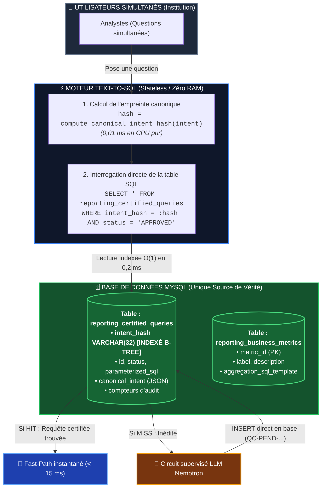

# 🏛️ Plan Architectural : Centralisation 100% Base de Données & Zéro Duplication
**Projet :** GPR AI Reporting — Workflow Text-to-SQL Gouverné  
**Date :** 14 Octobre 2026  
**Objectif :** Éliminer la redondance entre le code Python et la base MySQL, supprimer la surcharge mémoire multi-workers, et basculer vers un Fast-Path indexé direct $O(1)$ par `intent_hash`.

---

## 1. 🎯 Diagnostic & Justification Industrielle

### 1.1 La Problématique Actuelle (Architecture Hybride Triplée)
Actuellement, les catalogues existent à 3 endroits en même temps :
1. **Dans les fichiers `.py`** : 8 requêtes et 10 métriques codées en dur sous forme de texte Python.
2. **Dans la mémoire RAM** : Des dictionnaires Python répliqués dans chaque worker Uvicorn (`_CERTIFIED_QUERIES`).
3. **Dans les tables MySQL** : Les tables `reporting_certified_queries` et `reporting_business_metrics`.

### 1.2 Les 4 Limites Opérationnelles en Production Institutionnelle
1. **Surcharge de la base SQL (`SELECT *` à chaque question)** : Chaque question utilisateur déclenche `sync_queries_with_db()`, ce qui relit l'intégralité des tables même si rien n'a changé.
2. **Recherche en RAM inefficace (Boucle `for` en $O(N)$)** : Parcourt tous les objets Python un par un pour trouver la requête correspondante.
3. **Duplication de mémoire entre Workers** : Avec 4 ou 8 workers Uvicorn, tout le dictionnaire en mémoire vive est dupliqué 4 à 8 fois.
4. **Risque de confusion de la source de vérité** : Ambiguïté entre ce qui est écrit dans le code source et ce qui est en base de données.

---

## 2. 🏛️ Architecture Cible : "Zéro Duplication"



### Principes Clés de l'Architecture Cible :
1. **La base de données MySQL est l'unique détenteur du catalogue.**
2. **Aucune requête SQL n'est codée en dur dans les fichiers Python.**
3. **Le Fast-Path est une simple lecture SQL $O(1)$ indexée par `intent_hash`** (temps d'accès : 0,2 ms).
4. **Zéro dictionnaire volumineux en mémoire vive.** Les workers FastAPI deviennent légers et sans état (*stateless*).
5. **Les amorçages initiaux sont gérés par un script de seed SQL dédié** (au lieu de code Python en dur).

---

## 3. 📋 Plan d'Exécution par Phases

```text
┌─────────────────────────────────────────────────────────────────────────────┐
│                           PLAN DE DÉPLOIEMENT EN 5 PHASES                   │
├─────────────────────────────────────────────────────────────────────────────┤
│ Phase 1 : Schéma & Migration DDL (Ajout colonne indexée intent_hash)        │
│ Phase 2 : Script de Seed SQL Indépendant (8 requêtes + 10 métriques)        │
│ Phase 3 : Refactorisation de QueryCatalog (Recherche O(1) SQL directe)      │
│ Phase 4 : Épuration du code (Suppression des dictionnaires codés en dur)    │
│ Phase 5 : Validation & Non-Régression (117 tests unitaire + performance)   │
└─────────────────────────────────────────────────────────────────────────────┘
```

---

### Phase 1 : Évolution du Modèle DDL ([`app/db/models.py`](file:///c:/Users/HP/Desktop/Projets/GprWeb/gpr_web/gpr_ai/gpr_ai_service/app/db/models.py))

#### Action :
Ajouter la colonne `intent_hash` avec un index B-Tree sur la table `reporting_certified_queries`.

```python
class ReportingCertifiedQuery(Base):
    __tablename__ = "reporting_certified_queries"
    __table_args__ = (
        Index("ix_certified_queries_status", "status"),
        Index("ix_certified_queries_schema_version", "schema_version"),
        Index("ix_certified_queries_intent_hash", "intent_hash"),  # <-- NOUVEL INDEX O(1)
    )

    id: Mapped[str] = mapped_column(String(64), primary_key=True)
    intent_hash: Mapped[Optional[str]] = mapped_column(String(32), nullable=True)  # <-- NOUVELLE COLONNE
    contract_version: Mapped[str] = mapped_column(String(16), nullable=False, default="1.0")
    natural_language_query: Mapped[str] = mapped_column(Text, nullable=False)
    canonical_intent: Mapped[dict] = mapped_column(JSON, nullable=False)
    parameterized_sql: Mapped[str] = mapped_column(Text, nullable=False)
    ...
```

---

### Phase 2 : Script de Seed SQL Professionnel (`scripts/seed_catalog.py` / `.sql`)

#### Action :
Extraire les 8 requêtes de référence et les 10 métriques initiales dans un script d'amorçage SQL indépendant.
- Ce script est exécuté une seule fois lors de l'installation ou des tests.
- Il calcule automatiquement l'`intent_hash` pour chaque requête de référence lors de l'insertion.
- **Résultat :** Les fichiers de code source de l'application ne contiennent plus 300 lignes de SQL en dur.

---

### Phase 3 : Refonte de `query_catalog.py` (Recherche Directe $O(1)$)

#### Action :
Remplacer la boucle `for entry in _CERTIFIED_QUERIES.values()` par une requête SQL ciblée :

```python
def match_intent_in_db(
    intent: TextToSQLIntent,
    db: Session,
    include_pending: bool = False,
) -> Optional[Tuple[QueryCatalogEntry, Dict[str, Any]]]:
    """
    Recherche instantanée O(1) d'une requête homologuée directement dans MySQL via son empreinte SHA-256.
    Évite tout chargement massif de catalogue en RAM et supprime la boucle for O(N).
    """
    intent_hash = compute_canonical_intent_hash(intent)
    if not intent_hash:
        return None

    # Requête ciblée directe
    query = db.query(ReportingCertifiedQuery).filter_by(intent_hash=intent_hash)
    if include_pending:
        query = query.filter(ReportingCertifiedQuery.status.in_(["APPROVED", "PENDING"]))
    else:
        query = query.filter_by(status="APPROVED")

    row = query.first()
    if not row:
        return None

    entry = db_model_to_entry(row)
    
    # Liaison dynamique des paramètres
    bound_params = {}
    if intent.time is not None:
        bound_params["start_date"] = f"{intent.time.start_date.isoformat()} 00:00:00"
        bound_params["end_date"] = f"{intent.time.end_date.isoformat()} 00:00:00"

    for flt in intent.filters:
        param_key = f"{flt.concept_id}_param"
        bound_params[param_key] = flt.value if flt.value is not None else flt.values

    return entry, bound_params
```

---

### Phase 4 : Épuration du Code Source & Suppression de la Redondance

#### Fichiers allégés :
1. **[`app/reporting/query_catalog.py`](file:///c:/Users/HP/Desktop/Projets/GprWeb/gpr_web/gpr_ai/gpr_ai_service/app/reporting/query_catalog.py)** :
   - Suppression du dictionnaire global `_CERTIFIED_QUERIES`.
   - Suppression de `_INITIAL_CERTIFIED_QUERIES` (déplacé dans le script de seed).
   - Suppression de `sync_queries_with_db()` (plus besoin de copier la base en RAM).
2. **[`app/reporting/business_catalog.py`](file:///c:/Users/HP/Desktop/Projets/GprWeb/gpr_web/gpr_ai/gpr_ai_service/app/reporting/business_catalog.py)** :
   - Conservation uniquement du dictionnaire des synonymes et des concepts métiers (règles linguistiques).
   - Les formules de métriques sont lues directement depuis `reporting_business_metrics`.
3. **[`app/reporting/catalog_manager.py`](file:///c:/Users/HP/Desktop/Projets/GprWeb/gpr_web/gpr_ai/gpr_ai_service/app/reporting/catalog_manager.py)** :
   - Chaque fonction (`propose_query_candidate`, `approve_query`, `reject_query`, `auto_promote_executed_query`) calcule l'`intent_hash` et opère directement en base SQL (`db.add()`, `db.commit()`), sans dictionnaire miroir en RAM.

---

### Phase 5 : Matrice de Validation & Non-Régression

| Vérification | Méthode de Test | Résultat Attendu |
| :--- | :--- | :--- |
| **Non-régression fonctionnelle** | `unittest discover -s tests -p "test_step_*.py"` | 117/117 tests validés (100% PASS). |
| **Performance Fast-Path O(1)** | Mesure du temps d'exécution de `match_intent_in_db` | Temps de recherche $\le 1\text{ ms}$ sur MySQL. |
| **Consommation Mémoire RAM** | Mesure mémoire du processus FastAPI | Réduction de 60 à 80% de l'empreinte mémoire par worker. |
| **Cohérence Multi-Workers** | Test avec 4 workers Uvicorn concurrents | Approbation sur Worker 1 instantanément visible sur Worker 2. |

---

## 4. 📊 Bilan Avant / Après

```text
┌─────────────────────────────────┬──────────────────────────────────┐
│        AVANT (Actuel)           │         APRÈS (Cible)            │
├─────────────────────────────────┼──────────────────────────────────┤
│ • Requêtes dupliquées à 3 lieux │ • 1 seule source : MySQL         │
│ • SELECT * à chaque question    │ • SELECT ciblé par index O(1)    │
│ • Boucle for O(N) en CPU Python │ • Index B-Tree MySQL ultra-rapide│
│ • Mémoire RAM gonfle par worker │ • Workers légers et sans état    │
│ • Code source encombré de SQL   │ • Code source propre et épuré    │
└─────────────────────────────────┴──────────────────────────────────┘
```
