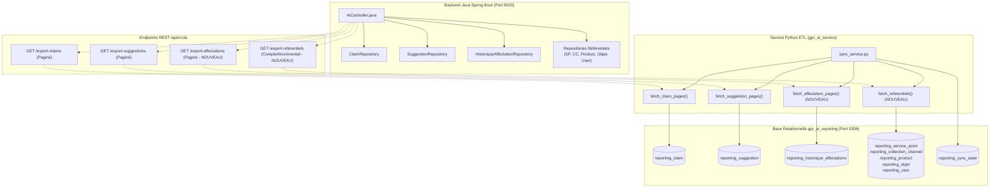

# Plan de Mise à Niveau : Synchronisation Complète des Tables `gpr_ai_reporting`
**Méthodologie Safe Code Change — Version 1.0.0**
**Date :** 16 Octobre 2026
**Cible :** Backend Spring Boot (`gpr_server_sicma_new_version`) & Service Python ETL (`gpr_ai_service`)

---

## 1. Contexte & Diagnostic de l'Existant

### 1.1 Constat Factuel
La base de données relationnelle **`gpr_ai_reporting`** comporte **17 tables**, mais le pipeline de synchronisation ETL actuel ne couvre en flux continu que **2 tables** :
- `reporting_claim` (52 lignes synchronisées)
- `reporting_suggestion` (3 lignes synchronisées)

Les 15 autres tables se trouvent dans un état disparate :
1. **5 tables de dimensions** (`reporting_service_point`, `reporting_collection_channel`, `reporting_product`, `reporting_categorie_objet`, `reporting_objet`) ne sont alimentées que par un vieux script SQL one-shot (`migration 007`) par déduplication de libellés texte. Tout nouvel objet créé dans Spring Boot n'est jamais synchronisé.
2. **6 tables de workflow et référentiels** (`reporting_historique_affectations`, `reporting_solution`, `reporting_satisfaction_measure`, `reporting_user`, `reporting_poste`, `reporting_existing_solution`) ont **0 ligne en base** car aucun flux d'export n'existe.
3. **4 tables internes IA/Gouvernance** (`reporting_business_metrics`, `reporting_certified_queries`, `reporting_alert`, `reporting_sync_state`) sont gérées localement par le service IA et ne nécessitent pas d'export Spring Boot.

### 1.2 Impact Critique sur le Moteur Text-to-SQL
Le catalogue de schémas (`schema_catalog.py`) et le catalogue de requêtes certifiées (`query_catalog.py`) contiennent déjà des requêtes interrogeant `reporting_historique_affectations` (ex: calcul du `reaffectation_count`). L'absence de synchronisation provoque des réponses à 0 résultat ou des jointures vides.

---

## 2. Matrice d'Alignement des 17 Tables

| # | Table Cible MariaDB | Entité Source Spring Boot | État Actuel | Priorité Sync | Action Requise |
| :-: | :--- | :--- | :-: | :-: | :--- |
| 1 | `reporting_claim` | `Claim` | 52 lignes | Active (OK) | Déjà enrichie (clés étrangères + `resolvedAt`). |
| 2 | `reporting_suggestion` | `Suggestion` | 3 lignes | Active (OK) | Déjà connectée (Option A & B validées). |
| 3 | `reporting_service_point` | `ServicePoint` | 4 lignes (one-shot) | **P1 (Haute)** | Flux dédié Référentiels (sync continue). |
| 4 | `reporting_collection_channel`| `CollectionChannel` | 4 lignes (one-shot) | **P1 (Haute)** | Flux dédié Référentiels (sync continue). |
| 5 | `reporting_product` | `Product` | 2 lignes (one-shot) | **P1 (Haute)** | Flux dédié Référentiels (sync continue). |
| 6 | `reporting_categorie_objet` | `CategorieObjet` | 6 lignes (one-shot) | **P1 (Haute)** | Flux dédié Référentiels (sync continue). |
| 7 | `reporting_objet` | `Objet` | 11 lignes (one-shot) | **P1 (Haute)** | Flux dédié Référentiels (sync continue). |
| 8 | `reporting_user` | `User` | 0 ligne | **P2 (Moyenne)** | Flux dédié Référentiels (sync continue). |
| 9 | `reporting_poste` | `Poste` | 0 ligne | **P2 (Moyenne)** | Flux dédié Référentiels (sync continue). |
| 10 | `reporting_existing_solution` | `ExistingSolution` | 0 ligne | **P3 (Basse)** | Flux dédié Référentiels (sync continue). |
| 11 | `reporting_historique_affectations` | `HistoriqueAffectation` | 0 ligne | **P1 (Haute)** | Flux paginé dédié (`/export-affectations`). |
| 12 | `reporting_solution` | `Solution` | 0 ligne | **P2 (Moyenne)** | Flux paginé dédié (`/export-solutions`). |
| 13 | `reporting_satisfaction_measure` | `SatisfactionMeasure` | 0 ligne | **P2 (Moyenne)** | Inclus dans l'export des solutions. |
| 14 | `reporting_sync_state` | *N/A (Local IA)* | 1 ligne | Active (OK) | Géré en local dans `sync_service.py`. |
| 15 | `reporting_alert` | *N/A (Local IA)* | 5 lignes | Active (OK) | Géré par le moteur de détection IA. |
| 16 | `reporting_certified_queries` | *N/A (Local IA)* | 16 lignes | Active (OK) | Géré par le catalogue de gouvernance. |
| 17 | `reporting_business_metrics` | *N/A (Local IA)* | 17 lignes | Active (OK) | Géré par le référentiel des 17 métriques. |

---

## 3. Architecture Cible de Synchronisation Unifiée

---

## 4. Découpage en 3 Phases d'Implémentation Séquentielles

### Phase 1 : Synchronisation du Workflow d'Affectation (`reporting_historique_affectations`) — [FAIT & VALIDÉ 100%]
*Objectif : Rendre opérationnelle la métrique de réaffectation et le suivi des délais d'affectation des agents.*
*Statut : **Terminé avec succès** (16/10/2026).*

1. **Backend Spring Boot** (`gpr_server_sicma_new_version`) :
   - `ExportAffectationDto.java` créé (mappings complets des champs de l'entité `HistoriqueAffectation`).
   - `ExportAffectationsResponse.java` créé (wrapper paginé standard).
   - Requête curseur ajoutée dans `HistoriqueAffectationRepository.java` (`findReportingAffectations`).
   - Endpoint `@GetMapping("/export-affectations")` exposé dans `AiController.java` avec pagination bornée et tri déterministe.
   - Tests validés : `AiControllerTest` (3/3 tests PASS, BUILD SUCCESS).
2. **Service Python ETL** (`gpr_ai_service`) :
   - Modèle ORM `ReportingHistoriqueAffectation` déclaré dans `app/db/models.py`.
   - `affectation_values()`, `fetch_affectation_pages()` (avec résilience 404), `upsert_affectations_with_metrics()`, et `perform_sync_affectations()` implémentés dans `app/services/sync_service.py`.
   - Intégration dans `perform_sync(target="affectations"|"all")` et curseur d'état `spring_boot_affectations` dans `reporting_sync_state`.
   - Statut exposé dans `GET /sync/status` via `app/routers/sync.py`.
3. **Tests & Validation de Non-Régression** :
   - Tests unitaires et d'intégration validés dans `tests/test_reporting_sync.py` (12/12 tests PASS).
   - Tests de régression validés sur `tests/test_reporting_database.py` et `tests/test_file_utils.py` (19/19 tests PASS).

---

### Phase 2 : Synchronisation Continue des Référentiels & Dimensions (`reporting_service_point`, `reporting_collection_channel`, `reporting_product`, `reporting_categorie_objet`, `reporting_objet`, `reporting_user`, `reporting_poste`) — [FAIT & VALIDÉ 100%]
*Objectif : Synchroniser automatiquement les agences, canaux, produits, catégories, motifs (avec SLA/risque), utilisateurs et postes en éliminant le besoin de scripts SQL manuels.*
*Statut : **Terminé avec succès** (16/10/2026).*

1. **Backend Spring Boot** (`gpr_server_sicma_new_version`) :
   - `ExportReferentielsResponse.java` créé avec 7 DTOs internes (`ServicePointDto`, `CollectionChannelDto`, `ProductDto`, `CategorieObjetDto`, `ObjetDto`, `UserDto`, `PosteDto`).
   - Injection des 7 repositories Spring Data correspondants dans `AiController.java`.
   - Endpoint `@GetMapping("/export-referentiels")` exposé dans `AiController.java`, sérialisant les entités actives sans pagination (volume compact de référentiels).
   - Tests validés : `AiControllerTest` (`testExportReferentielsReturnsAllDimensions` + 3 tests existants = 4/4 tests PASS, BUILD SUCCESS).
2. **Service Python ETL** (`gpr_ai_service`) :
   - Déclaration des 7 modèles ORM dans `app/db/models.py` (`ReportingPoste`, `ReportingServicePoint`, `ReportingCollectionChannel`, `ReportingProduct`, `ReportingCategorieObjet`, `ReportingObjet`, `ReportingUser`).
   - Constantes `JAVA_EXPORT_REFERENTIELS_URL` et `SYNC_REFERENTIELS_NAME = "spring_boot_referentiels"` définies dans `app/services/sync_service.py`.
   - `fetch_referentiels(session)` implémenté avec résilience 404 (retourne dictionnaire vide sans crasher le cycle de synchronisation global).
   - `_upsert_dimension_items()` et `upsert_referentiels_with_metrics()` implémentés avec gestion intelligente des conflits d'unicité et mise à jour en place des attributs.
   - `perform_sync_referentiels()` et intégration prioritaire dans `perform_sync(target="referentiels"|"all")` (les dimensions sont synchronisées en premier afin de résoudre les clés étrangères des réclamations/suggestions).
   - Statut exposé dans `GET /sync/status` via `app/routers/sync.py`.
3. **Tests & Validation de Non-Régression** :
   - Tests unitaires `test_upsert_referentiels_creates_and_updates`, `test_fetch_referentiels_handles_404`, et `test_perform_sync_targets` validés dans `tests/test_reporting_sync.py` (14/14 tests PASS).
   - Tests complets `tests/test_reporting_sync.py`, `tests/test_reporting_database.py`, `tests/test_file_utils.py` (21/21 tests PASS).

---

### Phase 3 : Synchronisation Fine des Solutions & Mesures de Satisfaction (`reporting_solution`, `reporting_satisfaction_measure`) — [FAIT & VALIDÉ 100%]
*Objectif : Alimenter `reporting_solution` et `reporting_satisfaction_measure` pour l'historique détaillé des solutions proposées/validées/rejetées et des évaluations de satisfaction client.*
*Statut : **Terminé avec succès** (16/10/2026).*

1. **Backend Spring Boot** (`gpr_server_sicma_new_version`) :
   - `ExportSolutionDto.java` créé (avec sous-DTO `ExportSatisfactionMeasureDto` intégré pour sérialiser la mesure de satisfaction 1-to-1 associée).
   - `ExportSolutionsResponse.java` créé (wrapper paginé standard).
   - Requête curseur paginée `findReportingSolutions` ajoutée dans `SolutionRepository.java` avec gestion de repli `COALESCE(s.updatedAt, s.createdAt)`.
   - Injection de `SolutionRepository` et exposition de l'endpoint `@GetMapping("/export-solutions")` dans `AiController.java` avec pagination par lots (500 par défaut) et tri déterministe.
   - Tests validés : `AiControllerTest` (`testExportSolutionsReturnsPagedResponse` + 4 tests existants = 5/5 tests PASS, BUILD SUCCESS).
2. **Service Python ETL** (`gpr_ai_service`) :
   - Déclaration des modèles ORM `ReportingSolution` et `ReportingSatisfactionMeasure` dans `app/db/models.py`.
   - Constantes `JAVA_EXPORT_SOLUTIONS_URL` et `SYNC_SOLUTIONS_NAME = "spring_boot_solutions"` définies dans `app/services/sync_service.py`.
   - `solution_values()` et `satisfaction_measure_values()` avec parsing robuste des dates UTC, statuts et booléens IA.
   - `fetch_solution_pages()` avec pagination continue et résilience 404 (non-bloquant).
   - `upsert_solutions_with_metrics()` garantissant l'intégrité référentielle : résolution de `claim_id` vers `reporting_claim` et vérification des clés étrangères (`author_id`, `approver_id`, `measurer_id`) pour éviter toute violation de contrainte MariaDB.
   - `perform_sync_solutions()` et intégration dans `perform_sync(target="solutions"|"all")`.
   - Statut exposé dans `GET /sync/status` via `app/routers/sync.py`.
3. **Tests & Validation de Non-Régression** :
   - Tests unitaires `test_solution_values_maps_payload`, `test_fetch_solution_pages_handles_404`, `test_upsert_solutions_creates_and_updates`, `test_upsert_solutions_ignores_missing_claim`, et `test_perform_sync_targets` validés dans `tests/test_reporting_sync.py` (17/17 tests PASS).
   - Tests complets `tests/test_reporting_sync.py`, `tests/test_reporting_database.py`, `tests/test_file_utils.py` (25/25 tests PASS).

---

## 5. Matrice de Risques & Règles de Non-Régression (Safe Code Change)

| Risque Identifié | Impact Potentiel | Mesure de Protection Stricte |
| :--- | :--- | :--- |
| **Volumétrie élevée des affectations** | Latence ou timeout HTTP | Pagination stricte par lots de 500 (`page`, `size`) et tri déterministe `updatedAt ASC, id ASC`. |
| **Absence d'un endpoint sur une ancienne version Spring Boot** | Blocage complet du cron sync | Fallback HTTP 404 non-bloquant : si l'endpoint retourne 404, le service logue un warning et poursuit la synchronisation des autres tables sans crasher. |
| **Contraintes de clés étrangères MariaDB** | Échec d'insertion si un parent n'existe pas | Ordre d'ingestion strict : **1. Référentiels $\rightarrow$ 2. Claims & Suggestions $\rightarrow$ 3. Affectations & Solutions**. |
| **Désynchronisation des identifiants** | Données orphelines | Sauvegarde systématique de l'ID source d'origine dans chaque table. |

---

## 6. Planning d'Exécution Recommandé

- **Étape 1 (Prioritaire)** : Exécution de la **Phase 1** (Workflow des Affectations) $\rightarrow$ permet de débloquer immédiatement les métriques de réaffectation et d'activité agents.
- **Étape 2** : Exécution de la **Phase 2** (Référentiels & Dimensions automatiques) $\rightarrow$ garantit la cohérence permanente des agences, canaux et produits.
- **Étape 3** : Exécution de la **Phase 3** (Solutions et Mesures détaillées) $\rightarrow$ finalisation de l'analyse qualitative.
