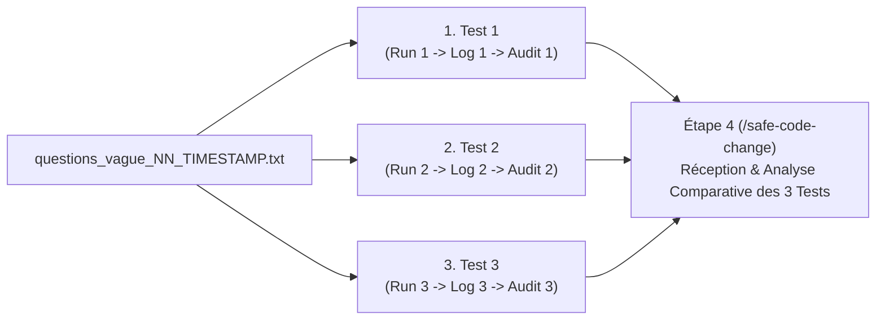
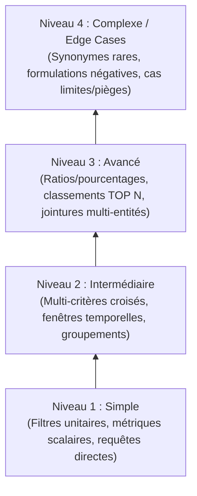
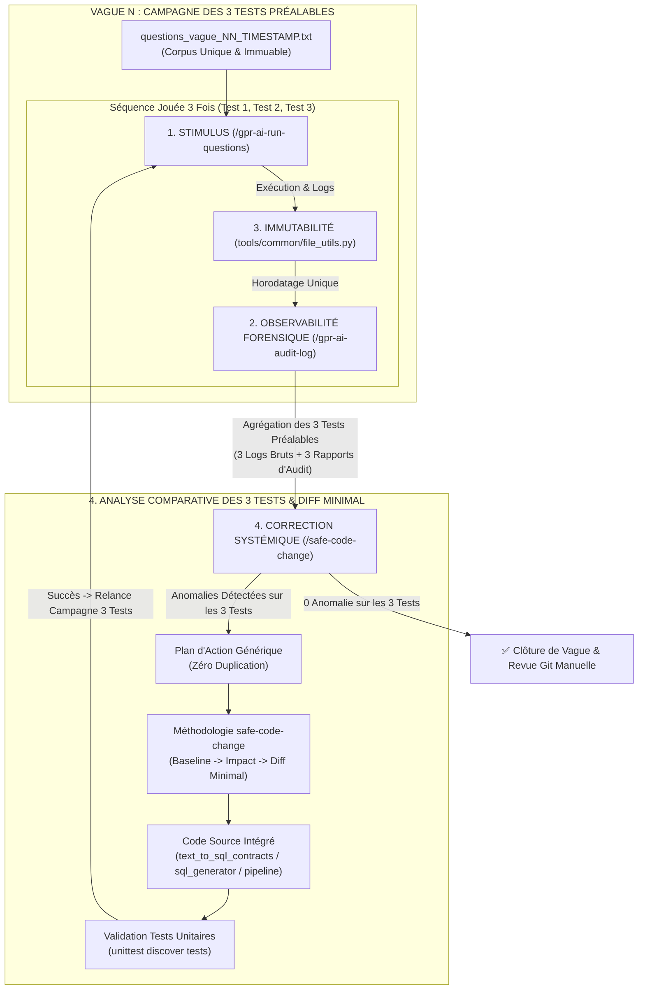

# Workflow de Gouvernance, Test, Analyse et Correction Sécurisée (GPR AI)

> **Statut** : Standard Opérationnel Officiel  
> **Date d'adoption** : 15 Octobre 2026  
> **Périmètre** : Service de Reporting Text-to-SQL Gouverné (`gpr_ai_service`)  
> **Auteurs / Décisionnaires** : Équipe Architecture & Gouvernance IA  

---

## 1. Philosophie et Vision du Workflow

Ce workflow formalise une **boucle fermée de gouvernance et d'assurance qualité logicielle (*Closed-Loop Autonomous Governance*)** conçue pour le moteur Text-to-SQL de GPR Banque.

### Principes Directeurs Fondamentaux :
1. **Conception Générique vs Pansement Ad-hoc** : 
   Ne jamais appliquer de correction spécifique à un cas isolé (ex: conditionner un correctif à une question précise). Tout problème doit être analysé comme le symptôme d'une classe de problèmes et résolu par un algorithme ou une fonction générique prévenant les variantes futures.
2. **Sanctuarisation de l'Existant & Zéro Duplication** :
   Les correctifs doivent s'intégrer strictement dans les composants existants du projet. Aucune duplication de code, de fonction ou création de fichier superflu n'est tolérée dans `app/reporting/`.
3. **Immutabilité Forensique (Zéro Écrasement)** :
   Toutes les traces d'exécution, journaux bruts, rapports, données d'audit ainsi que les fichiers de questions en entrée doivent être conservés avec une empreinte unique (nom unique horodaté/versionné). L'écrasement de données ou l'usage d'un nom générique réécrit est formellement interdit.
4. **Contrôle Humain du Versionnement Git** :
   Aucune mutation de l'arbre Git (`git add`, `git commit`, `git push`, `git checkout`) ne peut être déclenchée automatiquement. Les commandes doivent être fournies en texte clair pour revue et validation manuelle.
5. **Trilogie Préalable des 3 Tests (Avant l'Étape 4)** :
   Pour chaque vague, la séquence **[Étape 1 : Stimulus $\rightarrow$ Étape 3 : Immutabilité $\rightarrow$ Étape 2 : Audit]** est obligatoirement exécutée **3 fois de suite** avant d'accéder à l'Étape 4. L'Étape 4 reçoit donc les résultats consolidés des 3 tests afin d'éliminer l'aléa stochastique du LLM, observer la reproductibilité et analyser l'évolution du cache/circuits courts sur 3 passages successifs.
6. **Renouvellement Gradué du Corpus de Questions (Progression de Complexité & Nom Unique)** :
   À chaque nouvelle vague, un nouveau fichier de questions portant obligatoirement un **nom unique horodaté** (ex: `questions_vague_<NN>_<TIMESTAMP>.txt`) est créé avec de nouveaux cas d'usage non encore testés, organisés selon une pyramide de difficulté ascendante (du plus simple au plus complexe).

---

## 2. Structure d'une Vague de Test & Évolution du Corpus de Questions

Pour garantir que le moteur Text-to-SQL ne soit pas seulement optimisé pour un jeu de questions figé, l'assurance qualité repose sur un principe de **vagues progressives**.

### 2.1 La Règle des 3 Tests Préalables à l'Étape 4
Avant toute intervention au Step 4 (`/safe-code-change`), une campagne complète de **3 tests successifs** est obligatoirement réalisée sur le fichier unique de la vague :
1. **Exécution 1 (Test 1)** :
   - Étape 1 : Injection de `questions_vague_<NN>_<TIMESTAMP>.txt`
   - Étape 3 : Sauvegarde immuable $\rightarrow$ `workflow_execution_1.log`
   - Étape 2 : Audit forensique $\rightarrow$ `RAPPORT_AUDIT_1.md` + `audit_data_1.json`
2. **Exécution 2 (Test 2)** :
   - Étape 1 : Rejeu de `questions_vague_<NN>_<TIMESTAMP>.txt`
   - Étape 3 : Sauvegarde immuable $\rightarrow$ `workflow_execution_2.log`
   - Étape 2 : Audit forensique $\rightarrow$ `RAPPORT_AUDIT_2.md` + `audit_data_2.json`
3. **Exécution 3 (Test 3)** :
   - Étape 1 : Rejeu de `questions_vague_<NN>_<TIMESTAMP>.txt`
   - Étape 3 : Sauvegarde immuable $\rightarrow$ `workflow_execution_3.log`
   - Étape 2 : Audit forensique $\rightarrow$ `RAPPORT_AUDIT_3.md` + `audit_data_3.json`

**Ce n'est qu'après avoir réalisé ces 3 exécutions** que l'on passe à l'**Étape 4**, qui reçoit l'ensemble des 3 tests (les 3 logs et les 3 rapports d'audit) pour une analyse comparative complète.



### 2.2 Pyramide de Complexité des Questions (Du Plus Simple au Plus Complexe)
Pour chaque nouvelle vague, le fichier `questions.txt` intègre des cas encore jamais testés selon 4 paliers d'exigence croissante :



1. **Niveau 1 - Simple (Cas Nominaux & Requêtes Scalaires)** :
   - *Description* : Requêtes mono-critère directes sur des colonnes standards.
   - *Exemples* :
     - *"Combien de réclamations ont été enregistrées au total ?"*
     - *"Donne-moi les réclamations avec le statut TRAITEE."*
     - *"Nombre de suggestions reçues par canal EMAIL."*
   - *Objectif de validation* : Détection d'entité élémentaire, mapping direct des tables et filtres simples.

2. **Niveau 2 - Intermédiaire (Multi-Critères Croisés & Dimensions Temporelles)** :
   - *Description* : Combinaison de plusieurs filtres (statut + urgence + agence + date) et agrégations groupées.
   - *Exemples* :
     - *"Liste des réclamations urgentes de l'agence Plateau reçues le mois dernier."*
     - *"Nombre de réclamations par canal pour les comptes épargne au premier trimestre 2026."*
     - *"Répartition des suggestions par catégorie pour les clients satisfaits."*
   - *Objectif de validation* : Résolution des synonymes, normalisation des dates (`time_parser`), intégrité des clauses `WHERE` combinées et clauses `GROUP BY`.

3. **Niveau 3 - Avancé (Analyses Complexes, Ratios & Classements)** :
   - *Description* : Calculs de ratios, fonctions analytiques, fenêtres glissantes, tris avec limites et jointures avancées.
   - *Exemples* :
     - *"Quel est le taux de satisfaction des réclamations traitées sous 48 heures ?"*
     - *"Top 5 des agences ayant le plus fort volume de réclamations pour motif de fraude."*
     - *"Délai moyen de clôture des réclamations par catégorie de produit sur les 6 derniers mois."*
   - *Objectif de validation* : Sous-requêtes, calculs `DATEDIFF`, expressions mathématiques SQL (`COUNT(*) * 100.0 / NULLIF(...)`), intégrité des jointures inter-tables.

4. **Niveau 4 - Complexe / Edge Cases (Robustesse Sémantique & Cas Limites)** :
   - *Description* : Formulations implicites, tournures négatives, synonymes argotiques/métier rares, requêtes à la frontière du périmètre.
   - *Exemples* :
     - *"Quels sont les dossiers qui bloquent et qui ne sont toujours pas résolus ?"*
     - *"Affiche les retours clients mécontents sans passer par le guichet physique."*
     - *"Donne-moi les réclamations liées à des virements internationaux suspendus."*
   - *Objectif de validation* : Résilience face aux formulations non conventionnelles, absence de repli silencieux indu, absence d'hallucination de colonnes inexistantes.

---

## 3. Diagramme Synthétique de la Boucle Fermée



---

## 4. Détail Opérationnel des 4 Piliers & Fichiers Associés

### Pilier 1 : Le Stimulus (`/gpr-ai-run-questions`)
* **Commande utilisateur** :
  ```text
  /gpr-ai-run-questions @[questions_vague_<NN>_<TIMESTAMP>.txt]
  ```
* **Fichier fourni par l'utilisateur en entrée** :
  - `@[questions_vague_<NN>_<TIMESTAMP>.txt]` : **Uniquement** le corpus des questions analytiques de la **Vague active** avec son **nom unique et horodaté**.  
    *(Convention : `questions_vague_<NN>_<YYYYMMDD_HHMMSS>.txt`. Renouvelé à chaque vague selon la pyramide de complexité pour explorer de nouveaux cas : simple $\rightarrow$ complexe).*
* **Composants d'exécution** :
  - [`run_questions.py`](file:///c:/Users/HP/Desktop/Projets/GprWeb/gpr_web/gpr_ai/gpr_ai_service/run_questions.py) : Script orchestrateur CLI.
  - [`tools/workflow_interrogator/runner.py`](file:///c:/Users/HP/Desktop/Projets/GprWeb/gpr_web/gpr_ai/gpr_ai_service/tools/workflow_interrogator/runner.py) : Moteur d'exécution séquentielle.
  - [`app/reporting/text_to_sql_pipeline.py`](file:///c:/Users/HP/Desktop/Projets/GprWeb/gpr_web/gpr_ai/gpr_ai_service/app/reporting/text_to_sql_pipeline.py) : Pipeline traversant les 7 étapes.
* **Fichiers produits en sortie (horodatés)** :
  - `workflow_execution_<TIMESTAMP>.log` : Journal brut de l'exécution complète.
  - `RAPPORT_EXECUTION_QUESTIONS_<TIMESTAMP>.md` : Synthèse Markdown des résultats (statuts, modes, requêtes SQL, durées).

---

### Pilier 2 : L'Observabilité Forensique (`/gpr-ai-audit-log`)
* **Commande utilisateur** :
  ```text
  /gpr-ai-audit-log @[workflow_execution_<TIMESTAMP>.log]
  ```
* **Fichier fourni par l'utilisateur en entrée** :
  - `@[workflow_execution_<TIMESTAMP>.log]` : **Uniquement** le journal brut capturé au Pilier 1. *(L'utilisateur ne transmet ni rapport ni questions ici, l'outil analyse exclusivement le log brut).*
* **Composants d'analyse** :
  - [`tools/log_analyzer/analyzer.py`](file:///c:/Users/HP/Desktop/Projets/GprWeb/gpr_web/gpr_ai/gpr_ai_service/tools/log_analyzer/analyzer.py) : Moteur d'extraction et de confrontation des 7 contrats.
  - [`tools/log_analyzer/cli.py`](file:///c:/Users/HP/Desktop/Projets/GprWeb/gpr_web/gpr_ai/gpr_ai_service/tools/log_analyzer/cli.py) : Interface CLI d'audit forensique.
* **Fichiers produits en sortie (horodatés)** :
  - `RAPPORT_AUDIT_WORKFLOW_<TIMESTAMP>.md` : Rapport d'audit forensique des 7 contrats avec bilan statistique et liste des anomalies par Run.
  - `audit_data_workflow_<TIMESTAMP>.json` : Métriques et données JSON structurées de l'audit.

---

### Pilier 3 : L'Immutabilité Stricte (Zéro Écrasement)
* **Fichier fourni par l'utilisateur en entrée** :
  - **Aucun fichier.** Ce pilier est une **consigne et un standard de développement permanent** imposé par l'utilisateur : interdiction formelle que l'exécution d'un outil n'écrase un fichier existant.
* **Composant technique sous-jacent** :
  - [`tools/common/file_utils.py`](file:///c:/Users/HP/Desktop/Projets/GprWeb/gpr_web/gpr_ai/gpr_ai_service/tools/common/file_utils.py)
* **Fonctions clés** :
  ```python
  generate_unique_filepath(target_path: Path, timestamp: Optional[str] = None) -> Path
  safe_write_text(target_path: Path, content: str, timestamp: Optional[str] = None) -> Path
  ```
* **Garantie apportée** :
  Tous les fichiers des Piliers 1 et 2 sont automatiquement suffixés par l'horodatage universel `_YYYYMMDD_HHMMSS`. L'historique complet reste intègre et auditable pour des comparaisons longitudinales.
* **Test de verrouillage** :
  - [`tests/test_file_utils.py`](file:///c:/Users/HP/Desktop/Projets/GprWeb/gpr_web/gpr_ai/gpr_ai_service/tests/test_file_utils.py)

---

### Pilier 4 : Correction Systémique & Non-Régression (`/safe-code-change`)
* **Déclenchement** : Après achèvement obligatoire de la campagne des 3 tests préalables (ou dès qu'une anomalie doit être corrigée).
* **Fichiers fournis par l'utilisateur en entrée** :
  1. **Phase d'analyse comparative des anomalies** :
     L'utilisateur fournit obligatoirement **les 3 tests complets** réalisés avant le Step 4 :
     - `@[questions_vague_<NN>_<TIMESTAMP>.txt]` (Corpus unique de la vague)
     - Test 1 : `@[RAPPORT_AUDIT_WORKFLOW_1.md]` + `@[workflow_execution_1.log]`
     - Test 2 : `@[RAPPORT_AUDIT_WORKFLOW_2.md]` + `@[workflow_execution_2.log]`
     - Test 3 : `@[RAPPORT_AUDIT_WORKFLOW_3.md]` + `@[workflow_execution_3.log]`
     *(L'Étape 4 dispose ainsi d'un échantillon complet de 3 exécutions pour discerner les anomalies reproductibles de l'aléa du LLM et vérifier le comportement des circuits courts)*.
  2. **Phase d'exécution sécurisée** :
     Après rédaction et validation du plan d'action générique, l'utilisateur transmet :
     - `@[PLAN_EXECUTION_CORRECTIONS_GENERIQUES_ZERO_DUPLICATION_20261015.md]`
* **Fichiers sources modifiés (Chirurgical & Zéro Duplication)** :
  - [`app/reporting/text_to_sql_contracts.py`](file:///c:/Users/HP/Desktop/Projets/GprWeb/gpr_web/gpr_ai/gpr_ai_service/app/reporting/text_to_sql_contracts.py) : Validateur réflexif `IntentEntity` & normalisation de types.
  - [`app/reporting/sql_generator.py`](file:///c:/Users/HP/Desktop/Projets/GprWeb/gpr_web/gpr_ai/gpr_ai_service/app/reporting/sql_generator.py) : Dynamisation few-shot prompt (éradication des paramètres orphelins).
  - [`app/reporting/text_to_sql_pipeline.py`](file:///c:/Users/HP/Desktop/Projets/GprWeb/gpr_web/gpr_ai/gpr_ai_service/app/reporting/text_to_sql_pipeline.py) : Réservoir universel `filter_synonyms_map` & élagage réflexif.
* **Processus strict sans court-circuit** :
  1. Baseline (tests unitaires & git status).
  2. Analyse d'impact & conception générique (interdiction des patchs spécifiques).
  3. Diff minimal sans duplication dans `app/reporting/`.
  4. Validation croisée : Tests unitaires $\rightarrow$ Relance `/gpr-ai-run-questions` $\rightarrow$ Re-audit `/gpr-ai-audit-log` (objectif : 0 anomalie sur les 3 tests).
  5. Clôture de la vague avec 100 % de succès sur les 3 tests.
  6. Revue Git manuelle (commandes fournies en texte).

---

## 5. Tableau d'Évolution et d'Efficacité Observée (Vague 1 - Corpus Initial de 24 Questions)

L'application rigoureuse de la trilogie des 3 tests préalables sur la Vague 1 a produit les résultats mesurables suivants :

| Indicateur de Qualité | Test 1 (Initial / Découverte) | Test 2 (Stabilisation Intermédiaire) | Test 3 (Consolidation Finale) |
| :--- | :---: | :---: | :---: |
| **Erreurs SQL en base** | 1 (Run 07) | 1 (Run 07) | **0** |
| **Replis silencieux** | 1 (Run 09) | 1 (Run 09) | **0** |
| **Paramètres orphelins** | 14 | 11 | **0** |
| **Divergences SQL** | 0 | 0 | **0** |
| **Taux de Succès Global** | 91.7 % | 91.7 % | **100 %** |
| **Part des Circuits Courts** | ~12 % | ~12 % | **29.2 %** *(Fast-Path & Pending)* |
| **Temps moyen circuit court** | N/A | N/A | **< 6 secondes** *(vs 45s LLM)* |

---

## 6. Guide Pratique d'Exécution d'une Vague Complète

Pour exécuter une vague complète (3 tests préalables puis analyse/correction Step 4) :

```bash
# ==============================================================================
# PHASE 1 : CAMPAGNE DES 3 TESTS PRÉALABLES (STEP 1 -> STEP 3 -> STEP 2 x 3)
# ==============================================================================
# Corpus unique de la vague : questions_vague_NN_YYYYMMDD_HHMMSS.txt

# --- RUN 1 / TEST 1 ---
python run_questions.py questions_vague_01_20261015_095606.txt --report RAPPORT_EXECUTION_QUESTIONS.md --audit

# --- RUN 2 / TEST 2 ---
python run_questions.py questions_vague_01_20261015_095606.txt --report RAPPORT_EXECUTION_QUESTIONS.md --audit

# --- RUN 3 / TEST 3 ---
python run_questions.py questions_vague_01_20261015_095606.txt --report RAPPORT_EXECUTION_QUESTIONS.md --audit

# ==============================================================================
# PHASE 2 : STEP 4 - ANALYSE FORENSIQUE COMPARATIVE & /safe-code-change
# ==============================================================================
# Fournir au Step 4 le corpus unique et l'ensemble des 3 tests (Logs + Rapports).
#
# CAS A : ANOMALIES DÉTECTÉES SUR LES 3 TESTS
#    1. Élaborer PLAN_EXECUTION_CORRECTIONS_GENERIQUES_ZERO_DUPLICATION.md
#    2. Appliquer les corrections chirurgicales sans duplication via /safe-code-change
#    3. Valider les tests unitaires : python -m unittest discover tests
#    4. Relancer la campagne des 3 tests (Phase 1)
#
# CAS B : 0 ANOMALIE SUR LES 3 TESTS (EXCELLENCE ATTEINTE)
#    1. Effectuer la revue Git manuelle :
git status
git diff <fichiers_modifies>
git add <fichiers_modifies>
git commit -m "fix(reporting): resolution des anomalies vague N"

#    2. Créer questions_vague_02_<NOUVEAU_TIMESTAMP>.txt (Niveau supérieur) et démarrer la Vague 2 !
```
