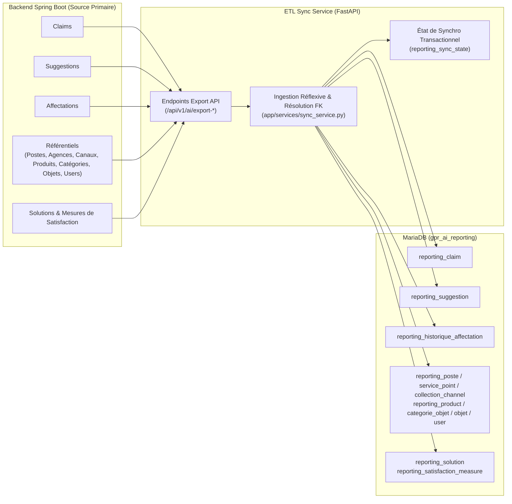
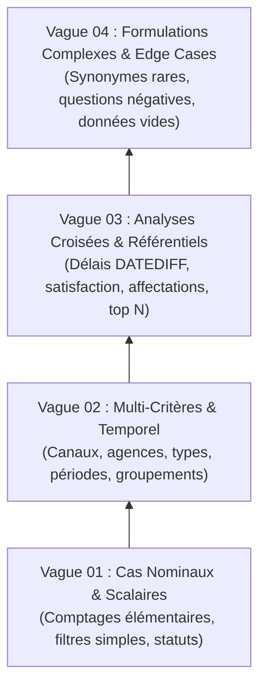
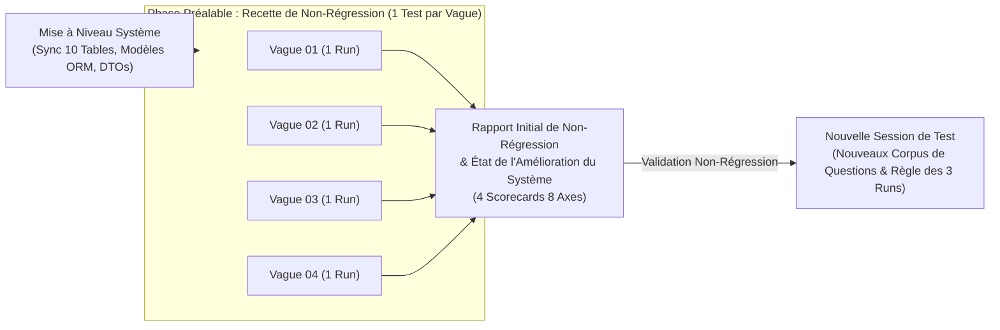
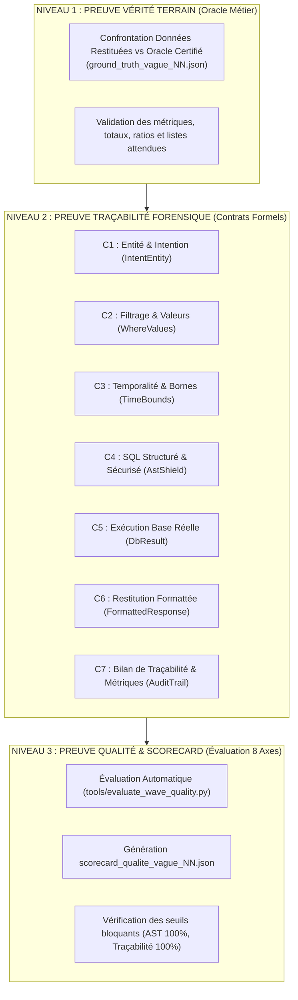
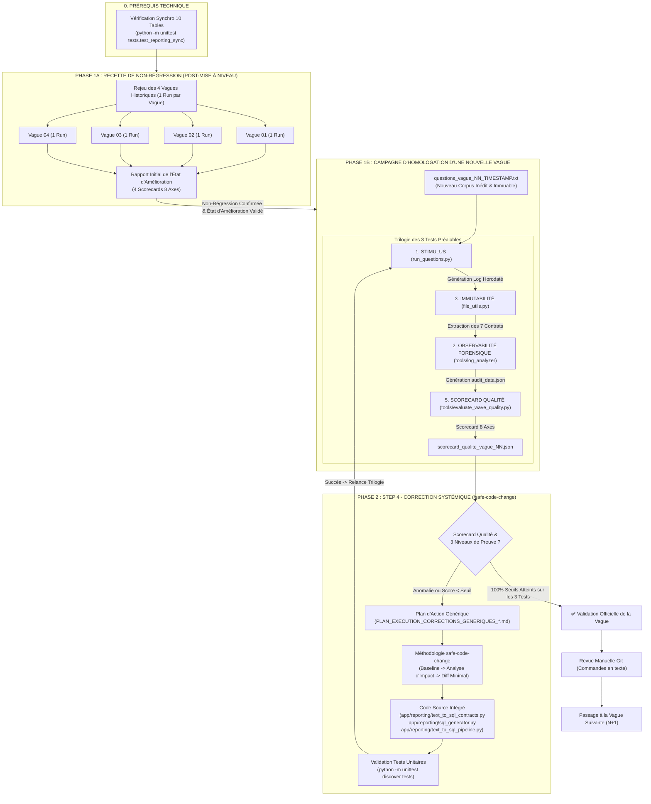

# Workflow de Gouvernance, Test, Analyse et Correction Sécurisée (GPR AI) - Version 2.0

> **Statut** : Standard Opérationnel Officiel & Référentiel de Validation  
> **Date d'adoption / Mise à niveau** : 16 Octobre 2026 (Évolution post-audit et synchronisation complète)  
> **Périmètre** : Service de Reporting Text-to-SQL Gouverné (`gpr_ai_service`) & Connecteurs Backend (`gpr_server_sicma_new_version`)  
> **Auteurs / Décisionnaires** : Équipe Architecture, Gouvernance IA & Auditeurs Externes  
> **Version précédente de référence** : [`WORKFLOW_GOUVERNANCE_TESTS_AUDIT_CORRECTIONS_20261015.md`](file:///c:/Users/HP/Desktop/Projets/GprWeb/gpr_web/gpr_ai/gpr_ai_service/WORKFLOW_GOUVERNANCE_TESTS_AUDIT_CORRECTIONS_20261015.md)

---

## 1. Philosophie et Vision du Workflow V2

Ce document établit le cadre normatif et méthodologique de la **boucle fermée de gouvernance et d'assurance qualité logicielle (*Closed-Loop Autonomous Governance*)** pour le moteur Text-to-SQL de GPR Banque.

La version 2.0 (16 Octobre 2026) intègre :
1. **L'Alimentation et Synchronisation Complète des 10 Tables Reporting** : Prérequis obligatoire garantissant la cohérence référentielle et métier entre la base applicative SICMA et la base d'analyse `gpr_ai_reporting`.
2. **L'Industrialisation Multi-Vagues (Vagues 01 à 04)** : Extension de la campagne de tests à l'ensemble du spectre analytique de la banque.
3. **Le Référentiel des 3 Niveaux de Preuve Forensique** : Définition formelle des preuves attendues pour valider toute restitution Text-to-SQL.
4. **La Grille Officielle d'Évaluation Qualité en 8 Axes** : Scorecard pondéré mesurant l'exactitude, la sécurité AST, la traçabilité et la performance.

### Principes Directeurs Fondamentaux :
1. **Conception Générique vs Pansement Ad-hoc** : 
   Ne jamais appliquer de correction spécifique à un cas isolé (ex: conditionner un correctif à une question précise). Tout problème doit être analysé comme le symptôme d'une classe de problèmes et résolu par un algorithme ou une fonction générique prévenant les variantes futures.
2. **Sanctuarisation de l'Existant & Zéro Duplication** :
   Les correctifs doivent s'intégrer strictement dans les composants existants du projet (`app/reporting/`). Aucune duplication de code, de fonction ou création de fichier superflu n'est tolérée.
3. **Immutabilité Forensique (Zéro Écrasement)** :
   Toutes les traces d'exécution, journaux bruts, rapports, scorecards, données d'audit ainsi que les fichiers de questions en entrée doivent être conservés avec une empreinte unique (nom unique horodaté/versionné). L'écrasement de données ou l'usage d'un nom générique réécrit est formellement interdit (géré par [`tools/common/file_utils.py`](file:///c:/Users/HP/Desktop/Projets/GprWeb/gpr_web/gpr_ai/gpr_ai_service/tools/common/file_utils.py)).
4. **Contrôle Humain du Versionnement Git** :
   Aucune mutation de l'arbre Git (`git add`, `git commit`, `git push`, `git checkout`) ne peut être déclenchée automatiquement. Les commandes doivent être fournies en texte clair pour revue et validation manuelle.
5. **Trilogie Préalable des 3 Tests (Avant l'Étape 4)** :
   Pour chaque nouvelle vague, la séquence **[Étape 1 : Stimulus $\rightarrow$ Étape 3 : Immutabilité $\rightarrow$ Étape 2 : Audit]** est obligatoirement exécutée **3 fois de suite** avant d'accéder à l'Étape 4. L'Étape 4 reçoit donc les résultats consolidés des 3 tests afin d'éliminer l'aléa stochastique du LLM, observer la reproductibilité et analyser l'évolution du cache/circuits courts sur 3 passages successifs.
6. **Confrontation Continue aux Oracles de Vérité Terrain** :
   Chaque question exécutée est confrontée automatiquement à son résultat attendu certifié (`ground_truth_vague_<NN>.json`), calculant l'écart d'Exactitude Métier.
7. **Distinction des Deux Régimes de Test (Recette 1-Run vs Homologation 3-Runs)** :
   - **Régime A : Recette de Non-Régression Post-Mise à Niveau (1 Run par Vague)** :  
     Après une amélioration majeure ou une refonte d'infrastructure (ex: synchronisation complète des 10 tables de reporting), les vagues déjà éprouvées et concluantes antérieurement (Vagues 01 à 04) sont rejouées avec **un seul test par vague**. Cela permet de dresser immédiatement le *Rapport Initial de l'État d'Amélioration* et de prouver que les corrections ont bonifié le système sans aucune régression fonctionnelle ou sémantique.
   - **Régime B : Homologation Nominale d'une Nouvelle Vague (Trilogie des 3 Runs)** :  
     S'applique lors du déploiement d'un nouveau corpus de questions inédit selon la pyramide de complexité pour neutraliser l'aléa stochastique du LLM et auditer la montée en charge des circuits courts.

---

## 2. Prérequis Fondamental : Intégrité & Synchronisation BDD (10 Tables)

Avant d'exécuter toute vague de test, le socle de données de `gpr_ai_reporting` doit être certifié à jour. Le système repose sur 10 tables synchronisées depuis le backend Spring Boot (`gpr_server_sicma_new_version`) vers le service Python (`gpr_ai_service`) via les endpoints `/api/v1/ai/export-*` :



### Table des Entités Synchronisées :
| Table Reporting | Entité Métier | Endpoint Spring Boot Source | Règle d'Intégrité / FK |
| :--- | :--- | :--- | :--- |
| `reporting_claim` | Réclamations | `/api/v1/ai/export-claims` | Statut, urgence, dates, canal, agence |
| `reporting_suggestion` | Suggestions | `/api/v1/ai/export-suggestions` | Statut, dates, canal, agence |
| `reporting_historique_affectation` | Parcours d'affectation | `/api/v1/ai/export-affectations` | `claim_id` $\rightarrow$ `reporting_claim` |
| `reporting_poste` | Postes collaborateurs | `/api/v1/ai/export-referentiels` | Référentiel organisationnel |
| `reporting_service_point` | Agences & points de service | `/api/v1/ai/export-referentiels` | Code agence, libellé, localisation |
| `reporting_collection_channel` | Canaux de collecte | `/api/v1/ai/export-referentiels` | EMAIL, GUICHET, COURRIER, WEB, etc. |
| `reporting_product` | Produits bancaires | `/api/v1/ai/export-referentiels` | Comptes, crédits, cartes, monétique |
| `reporting_categorie_objet` | Catégories de réclamation | `/api/v1/ai/export-referentiels` | Typologie de premier niveau |
| `reporting_objet` | Motifs détaillés | `/api/v1/ai/export-referentiels` | `category_id` $\rightarrow$ `reporting_categorie_objet` |
| `reporting_user` | Utilisateurs & agents | `/api/v1/ai/export-referentiels` | Profils, rôles, agences de rattachement |
| `reporting_solution` | Solutions apportées | `/api/v1/ai/export-solutions` | Résolution FK `claim_id`, `author_id`, `approver_id` |
| `reporting_satisfaction_measure`| Mesures de satisfaction | `/api/v1/ai/export-solutions` | Statut `SATISFIED`/`UNSATISFIED`, notes, `claim_id` |

---

## 3. Structure des 4 Vagues de Test & Pyramide de Complexité

Le banc d'essai couvre 4 vagues successives et complémentaires, organisées selon une difficulté croissante :



### 3.1 Détail des 4 Vagues Opérationnelles :
1. **Vague 01 - Cas Nominaux & Requêtes Scalaires** :
   - *Fichier stimulus* : [`questions_vague_01_20261015_095606.txt`](file:///c:/Users/HP/Desktop/Projets/GprWeb/gpr_web/gpr_ai/gpr_ai_service/questions_vague_01_20261015_095606.txt)
   - *Oracle de vérité terrain* : [`tests/fixtures/ground_truth_vague_01.json`](file:///c:/Users/HP/Desktop/Projets/GprWeb/gpr_web/gpr_ai/gpr_ai_service/tests/fixtures/ground_truth_vague_01.json)
   - *Cible* : Détection d'entités primaires (`reporting_claim`, `reporting_suggestion`), comptages simples, filtres mono-critères sur `status`.

2. **Vague 02 - Multi-Critères Croisés & Dimensions Temporelles** :
   - *Fichier stimulus* : [`questions_vague_02_20261015_192500.txt`](file:///c:/Users/HP/Desktop/Projets/GprWeb/gpr_web/gpr_ai/gpr_ai_service/questions_vague_02_20261015_192500.txt)
   - *Oracle de vérité terrain* : [`tests/fixtures/ground_truth_vague_02.json`](file:///c:/Users/HP/Desktop/Projets/GprWeb/gpr_web/gpr_ai/gpr_ai_service/tests/fixtures/ground_truth_vague_02.json)
   - *Cible* : Combinaison de filtres (statut + urgence + agence + canal), fenêtres temporelles relatives (`time_parser`), clauses `GROUP BY`.

3. **Vague 03 - Analyses Croisées, Ratios & Référentiels Avancés** :
   - *Fichier stimulus* : [`questions_vague_03_20261015_211523.txt`](file:///c:/Users/HP/Desktop/Projets/GprWeb/gpr_web/gpr_ai/gpr_ai_service/questions_vague_03_20261015_211523.txt)
   - *Oracle de vérité terrain* : [`tests/fixtures/ground_truth_vague_03.json`](file:///c:/Users/HP/Desktop/Projets/GprWeb/gpr_web/gpr_ai/gpr_ai_service/tests/fixtures/ground_truth_vague_03.json)
   - *Cible* : Taux de satisfaction, calculs de délais de résolution moyens (`DATEDIFF`), historique d'affectations, top agences/produits.

4. **Vague 04 - Robustesse Sémantique, Questions Négatives & Cas Limites** :
   - *Fichier stimulus* : [`questions_vague_04_20261015_214111.txt`](file:///c:/Users/HP/Desktop/Projets/GprWeb/gpr_web/gpr_ai/gpr_ai_service/questions_vague_04_20261015_214111.txt)
   - *Oracle de vérité terrain* : [`tests/fixtures/ground_truth_vague_04.json`](file:///c:/Users/HP/Desktop/Projets/GprWeb/gpr_web/gpr_ai/gpr_ai_service/tests/fixtures/ground_truth_vague_04.json)
   - *Cible* : Formulations implicites, exclusions ("sans passer par", "non résolues"), gestion des jeux de données vides, absence de repli silencieux indu.

### 3.2 Phase Préalable de Recette de Non-Régression (Banc 1-Run par Vague Historique 01 à 04)

Lorsqu'une amélioration d'infrastructure ou une mise à niveau structurelle est opérée sur le système (comme la synchronisation complète des 10 tables et la refonte des modèles ORM), et que les vagues 01 à 04 ont déjà été validées lors des cycles précédents, une phase spécifique de **Recette de Non-Régression** est intercalée avant toute nouvelle campagne d'homologation :



* **Principe d'Efficience** : Un seul passage par vague suffit amplement pour vérifier que les acquis historiques sont préservés et que les nouvelles structures de données améliorent le comportement global au lieu de créer des régressions.
* **Livrable de Recette** : Génération du *Rapport Initial de l'État d'Amélioration*, consolidant les métriques d'audit et les scorecards des 4 vagues.
* **Poursuite des Travaux** : Une fois la non-régression établie avec certitude sur ce schéma initial, le système peut accueillir en toute sécurité de nouvelles sessions de tests avec des questions inédites.

---

## 4. La Doctrine des 3 Niveaux de Preuve Forensique

Pour qu'un résultat soit certifié conforme par la gouvernance, il doit satisfaire simultanément **3 niveaux de preuve formels** :



1. **Preuve de Niveau 1 (Vérité Terrain Métier)** :
   - L'écart entre le résultat calculé par le workflow et l'oracle certifié doit être nul ou strictement inférieur à la marge d'arrondi admise ($\le 0.1\%$).
   - Toute divergence de total, de cardinalité ou de classification déclenche une anomalie de Niveau 1.
2. **Preuve de Niveau 2 (Traçabilité des 7 Contrats Formels)** :
   - Chaque question doit enregistrer dans le journal brut horodaté (`workflow_execution_<TIMESTAMP>.log`) la preuve formelle du passage des 7 contrats :
     - **Contrat 1** : Détection d'entité et intention réflexive (`IntentEntity`).
     - **Contrat 2** : Élagage et validation des filtres via les réservoirs canoniques (`WhereValues`).
     - **Contrat 3** : Normalisation temporelle certifiée sans injection libre (`TimeBounds`).
     - **Contrat 4** : Validation de l'arbre syntaxique SQL par le bouclier AST (`AstShield`, interdiction de `DROP`, `UPDATE`, `INSERT`, etc.).
     - **Contrat 5** : Exécution réelle sur `gpr_ai_reporting` sans erreur de syntaxe (`DbResult`).
     - **Contrat 6** : Synthèse métier claire et contextualisée (`FormattedResponse`).
     - **Contrat 7** : Horodatage, mode d'exécution (`fast_path`, `sql`, `fallback`), métriques de performance (`AuditTrail`).
3. **Preuve de Niveau 3 (Scorecard Qualité en 8 Axes)** :
   - Calcul chiffré du score global sur 100 points via la grille officielle.

---

## 5. Grille Officielle d'Évaluation Qualité en 8 Axes

| N° | Axe d'Évaluation | Poids | Description & Méthode de Mesure | Seuil Bloquant / Cible |
| :---: | :--- | :---: | :--- | :---: |
| **1** | **Exactitude Métier** | **25 %** | Confrontation directe avec l'oracle de vérité terrain (`ground_truth_vague_<NN>.json`). Conformité des montants, pourcentages et cardinalités. | $\ge 90.0\,\%$ |
| **2** | **Qualité de l'Interprétation** | **15 %** | Justesse de la détection d'intention, des entités tables cibles et des filtres métier sans hallucination. | $\ge 95.0\,\%$ |
| **3** | **Sécurité SQL & Bouclier AST** | **15 %** | Validation stricte `sqlglot` : 100 % requêtes `SELECT` pures, 0 injection, 0 clause destructrice, 0 paramètre orphelin. | **100.0 % (Bloquant)** |
| **4** | **Traçabilité & Preuves d'Audit** | **10 %** | Présence des 7 contrats formels dans le log d'exécution, journalisation immuable et métriques associées. | **100.0 % (Bloquant)** |
| **5** | **Reproductibilité & Stabilité** | **10 %** | Élimination de l'aléa du LLM sur la série des 3 tests préalables. Cohérence des réponses entre Run 1, Run 2 et Run 3. | $\ge 95.0\,\%$ |
| **6** | **Performance & Latence** | **10 %** | Mesure des latences par phase (interprétation, génération SQL, exécution DB, synthèse) et part des circuits courts. | P50 $< 5\,\text{s}$ / P95 $< 15\,\text{s}$ |
| **7** | **Robustesse & Données Vides** | **10 %** | Gestion gracieuse des requêtes sans résultat (absence d'erreur 500, messages d'absence de données explicites). | $\ge 95.0\,\%$ |
| **8** | **Qualité de Restitution** | **5 %** | Clarté de la formulation textuelle, exactitude des unités (taux en %, unités de réclamations), mise en page Markdown. | $\ge 90.0\,\%$ |

---

## 6. Architecture de la Boucle Fermée (Stimulus $\rightarrow$ Audit $\rightarrow$ Scorecard $\rightarrow$ Correction)



---

## 7. Guide Pratique d'Exécution & Commandes Opérationnelles

### Étape 0 : Contrôle de la Synchronisation BDD
```bash
# Vérifier l'intégrité de la synchronisation des 10 tables
python -m unittest tests.test_reporting_sync
python -m unittest tests.test_reporting_database
```

### Étape 1A : Phase de Recette de Non-Régression (1 Run par Vague 01 à 04)
*Cette phase établit le bilan de santé immédiat du système post-mise à niveau et produit le Rapport Initial de l'État d'Amélioration.*

```bash
# --- 1. VAGUE 01 (1 Run : Cas Nominaux & Scalaires) ---
python run_questions.py questions_vague_01_20261015_095606.txt --report RAPPORT_EXECUTION_VAGUE_01_NON_REGRESSION.md --audit
python tools/evaluate_wave_quality.py --wave-idx 1

# --- 2. VAGUE 02 (1 Run : Multi-Critères & Temporel) ---
python run_questions.py questions_vague_02_20261015_192500.txt --report RAPPORT_EXECUTION_VAGUE_02_NON_REGRESSION.md --audit
python tools/evaluate_wave_quality.py --wave-idx 2

# --- 3. VAGUE 03 (1 Run : Analyses Croisées & Référentiels) ---
python run_questions.py questions_vague_03_20261015_211523.txt --report RAPPORT_EXECUTION_VAGUE_03_NON_REGRESSION.md --audit
python tools/evaluate_wave_quality.py --wave-idx 3

# --- 4. VAGUE 04 (1 Run : Formulations Complexes & Cas Limites) ---
python run_questions.py questions_vague_04_20261015_214111.txt --report RAPPORT_EXECUTION_VAGUE_04_NON_REGRESSION.md --audit
python tools/evaluate_wave_quality.py --wave-idx 4
```

### Étape 1B : Campagne Nominale d'Homologation d'une Nouvelle Vague (Exemple Vague N)
*Cette phase s'applique sur tout nouveau corpus inédit de questions (`questions_vague_NN_<TIMESTAMP>.txt`) sous la règle des 3 runs successifs.*

```bash
# --- RUN 1 (Premier passage : découverte & baseline) ---
python run_questions.py questions_vague_NN_TIMESTAMP.txt --report RAPPORT_EXECUTION_QUESTIONS_RUN1.md --audit

# --- RUN 2 (Deuxième passage : circuits courts et cache) ---
python run_questions.py questions_vague_NN_TIMESTAMP.txt --report RAPPORT_EXECUTION_QUESTIONS_RUN2.md --audit

# --- RUN 3 (Troisième passage : consolidation & stabilité) ---
python run_questions.py questions_vague_NN_TIMESTAMP.txt --report RAPPORT_EXECUTION_QUESTIONS_RUN3.md --audit

# --- Évaluation Qualité Globale ---
python tools/evaluate_wave_quality.py --wave-idx NN
```

### Étape 2 : Traitement des Écarts & Décision Step 4 (/safe-code-change)
- **Si une anomalie survient (Niveau 1, 2 ou 3)** :
  1. L'anomalie est classée génériquement (aucun correctif spécifique pour une question donnée).
  2. Un plan d'action sans duplication est rédigé (`PLAN_EXECUTION_CORRECTIONS_GENERIQUES_*.md`).
  3. L'application du correctif suit strictement `/safe-code-change`.
  4. La trilogie des 3 tests est rejouée pour prouver la non-régression.
- **Si 0 anomalie et 100 % des seuils bloquants atteints** :
  1. Clôture de la vague active.
  2. Commandes de versionnement Git affichées pour l'utilisateur :
     ```bash
     git status
     git diff app/reporting/
     git add <fichiers_cibles>
     git commit -m "feat(reporting): validation vague NN conformite oracles et gouvernance V2"
     ```
  3. Démarrage de la vague suivante.
