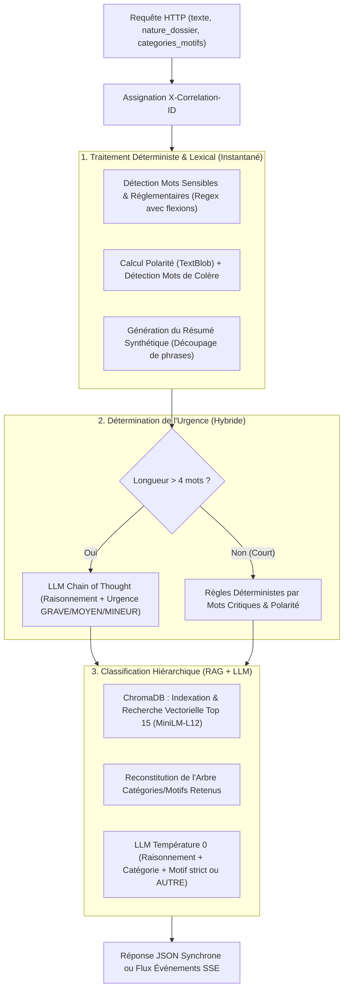
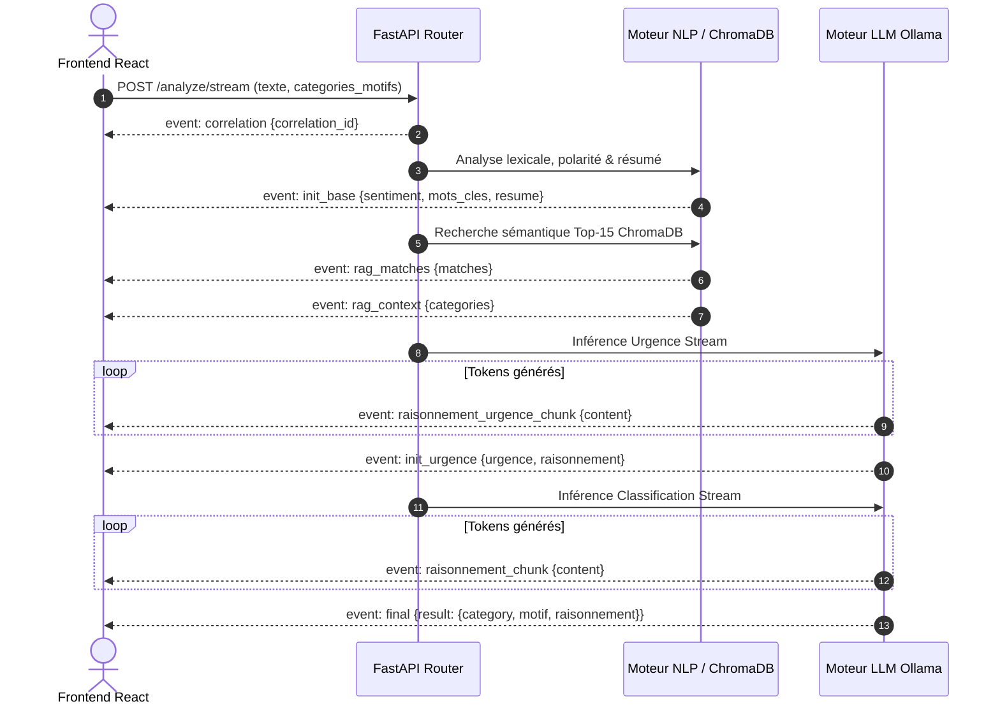

# 🔬 Spécification Détaillée : Pipeline d'Analyse NLP & Qualification Immédiate (`/analyze`)

> **Module** : GPR AI Service (`gpr_ai_service`)  
> **Composants** : [`app/routers/analyze.py`](file:///c:/Users/HP/Desktop/Projets/GprWeb/gpr_web/gpr_ai/gpr_ai_service/app/routers/analyze.py), [`app/services/nlp_service.py`](file:///c:/Users/HP/Desktop/Projets/GprWeb/gpr_web/gpr_ai/gpr_ai_service/app/services/nlp_service.py), [`app/services/llm_service.py`](file:///c:/Users/HP/Desktop/Projets/GprWeb/gpr_web/gpr_ai/gpr_ai_service/app/services/llm_service.py), [`app/services/vector_service.py`](file:///c:/Users/HP/Desktop/Projets/GprWeb/gpr_web/gpr_ai/gpr_ai_service/app/services/vector_service.py)  
> **Version** : 2.0  
> **Statut** : En production / Référentiel technique  

---

## 1. 🎯 Vision Métier & Rôle dans l'Architecture GPR

La pipeline `/analyze` constitue le point d'entrée de la **Collecte Intelligente (Module 1)** de la couche IA de GPR. Dès la saisie d'un dossier par un agent ou sa réception omnicanale (Guichet, Web, WhatsApp, transcription audio STT), cette pipeline traite le texte brut pour :
* **Détecter les signaux faibles et risques légaux/réglementaires** (*fraude, contentieux, avocat, BCEAO...*).
* **Évaluer la tonalité et l'indignation client** (analyse de sentiment et mots de colère).
* **Calculer le niveau d'urgence** (`GRAVE`, `MOYEN`, `MINEUR`) pour prioriser le traitement et alerter les superviseurs.
* **Classifier sémantiquement le dossier** en suggérant la **catégorie** et le **motif** conformes au référentiel officiel de la banque.
* **Générer un résumé synthétique** pour accélérer la prise de décision de l'agent.
* **Conserver le principe Human-in-the-Loop** : L'IA pré-remplit et conseille, l'agent valide ou ajuste.

---

## 2. 🏗️ Architecture Globale & Flux de Traitement



---

## 3. 🔌 Contrats d'Interface & Endpoints

### 3.1 Endpoint Synchrone : `POST /analyze/`

#### Schéma de la Requête (`TextRequest`)
```json
{
  "texte": "Je constate un prélèvement frauduleux de 150 000 FCFA sur mon compte que je n'ai jamais autorisé.",
  "categories_motifs": {
    "MONÉTIQUE ET CARTES": {
      "description": "Opérations cartes, DAB et terminaux de paiement",
      "motifs": [
        {
          "libelle": "UTILISATION FRAUDULEUSE DE CARTE",
          "description": "Débits frauduleux sans possession de carte ou piratage",
          "gravite": "GRAVE"
        },
        {
          "libelle": "DÉBIT SANS DÉLIVRANCE DE BILLETS",
          "description": "GAB débité sans délivrance des fonds",
          "gravite": "GRAVE"
        }
      ]
    },
    "GESTION DE COMPTE": {
      "description": "Tenue de compte, virements et commissions",
      "motifs": [
        {
          "libelle": "FRAIS INJUSTIFIÉS",
          "description": "Contestation d'agios ou commissions",
          "gravite": "MINEUR"
        }
      ]
    }
  },
  "nature_dossier": "RECLAMATION",
  "definition_nature": "Plainte formelle concernant un préjudice subi par un client."
}
```

#### Schéma de la Réponse JSON
```json
{
  "urgence": "GRAVE",
  "sentiment": "tres_negatif",
  "mots_cles_detectes": [
    "fraude"
  ],
  "resume": "Je constate un prélèvement frauduleux de 150 000 FCFA sur mon compte que je n'ai jamais autorisé.",
  "categorie_suggeree": "MONÉTIQUE ET CARTES",
  "motif_suggere": "UTILISATION FRAUDULEUSE DE CARTE",
  "raisonnement": "Le client signale un débit non autorisé de 150 000 FCFA s'apparentant à une utilisation frauduleuse de ses moyens de paiement, justifiant la catégorie Monétique et le motif Fraude.",
  "correlation_id": "90e6760b-8d75-47d0-8cb4-20d0f7ee1a8f"
}
```

---

### 3.2 Endpoint Réactif / Streaming : `POST /analyze/stream`

Retourne un flux continu **Server-Sent Events (`text/event-stream`)** permettant une restitution progressive dans l'interface agent :



---

## 4. ⚙️ Les 5 Piliers Algorithmiques Détaillés

### Pilier 1 — Détection des Signaux Faibles & Mots Sensibles

* **Dictionnaire réglementaire bancaire (`MOTS_SENSIBLES`)** :
  ```python
  MOTS_SENSIBLES = [
      "fraude", "arnaque", "piratage", "vol", "police", "tribunal",
      "avocat", "presse", "bceao", "cima", "médiateur", "huissier",
      "inadmissible", "honte", "urgence", "plainte", "scandale",
      "bloquer", "bloqué", "perdu", "perte"
  ]
  ```
* **Expression régulière insensible à la casse avec flexions françaises** :
  ```python
  pattern = rf"\b{mot}(é|ée|er|es|s)?\b"
  ```
* Tout mot matché est consigné dans `mots_cles_detectes` pour affichage sous forme de badges d'alerte et audit.

---

### Pilier 2 — Analyse de Sentiment & Détection d'Indignation

1. **Calcul de polarité** : Effectué via TextBlob sur le texte brut (score de $-1.0$ à $+1.0$).
2. **Lexique d'indignation** :
   ```python
   mots_colere = ["honte", "scandale", "inadmissible", "voleur", "arnaqueur", "inacceptable"]
   has_anger = any(m in text_lower for m in mots_colere)
   ```
3. **Attribution de la classe** :
   * `tres_negatif` : Si $\text{polarity} < -0.3$ ou `has_anger == True`.
   * `negatif` : Si $\text{polarity} < 0$.
   * `neutre` : Par défaut (ou `positif` en streaming si $\text{polarity} > 0.3$).

---

### Pilier 3 — Détermination de l'Urgence (Hybride)

1. **Cas Nominal ($\text{mots} > 4$)** : Évaluation cognitive via le LLM (`check_urgency_with_llm`).
   * Le LLM reçoit la nature du dossier, le texte, l'arbre hiérarchique et le contexte des procédures institutionnelles.
   * Obligation de produire une phrase d'explication préalable (`analyse_du_probleme`) avant de choisir l'urgence.
2. **Cas Court ($\le 4$ mots) ou Fallback Déterministe** :
   * Si mot critique présent (`fraude`, `vol`, `police`, `avocat`, `tribunal`, `bceao`, `bloquer`, `bloqué`, `perte`, `piratage`) $\rightarrow$ **`GRAVE`**.
   * Si $\ge 2$ mots sensibles détectés, ou $\text{polarité} \le -0.5$, ou présence d'indignation, ou $\ge 2$ points d'exclamation $\rightarrow$ **`MOYEN`**.
   * Sinon $\rightarrow$ **`MINEUR`**.

---

### Pilier 4 — Classification Sémantique Hiérarchique (RAG + LLM)

1. **Indexation & Cache d'arbre dans ChromaDB (`categories_collection`)** :
   * Chaque catégorie et motif est transformé en document vectoriel :
     $$\text{doc} = \text{"Catégorie: \{cat\}. Motif: \{motif\}. Description: \{desc\}. Gravité: \{gravite\}"}$$
   * Les embeddings sont calculés avec `paraphrase-multilingual-MiniLM-L12-v2` normalisés (norme $L_2$).
   * Un hash SHA-256 (`catalog_hash`) garantit que la collection n'est reconstruite que si l'arbre reçu a changé.
2. **Recherche Vectorielle Top-15** :
   * Le texte soumis est projeté dans l'espace vectoriel pour extraire les 15 éléments les plus proches.
3. **Reconstitution d'Arbre & Préservation Hiérarchique** :
   * Pour chaque catégorie touchée par le Top-15, **tous ses motifs frères sont conservés** afin que le LLM dispose de la vue complète de la famille concernée.
4. **Classification Supervisée par LLM à Température 0** :
   * Le LLM choisit la `category` et le `motif` correspondants.
   * **Règle impérative anti-hallucination** : Si le texte est hors sujet ou n'a aucun rapport avec les motifs disponibles, le LLM retourne obligatoirement `"AUTRE"` et `"AUTRE"`.
   * **Fallback Lexical** : Si aucun arbre n'est fourni, bascule sur un dictionnaire par défaut (`FINANCIER`, `TECHNIQUE`, `RELATIONNEL`).

---

### Pilier 5 — Résumé Synthétique

* Fonction `generate_short_summary` sans latence :
  * Si le texte comporte plus de deux phrases : extrait la première phrase + `[...]` + l'avant-dernière phrase.
  * Sinon : conserve les 200 premiers caractères tronqués proprement.

---

## 5. 📜 Prompts Utilisés dans la Pipeline (In Extenso)

### 5.1 Évaluation de l'Urgence & Gravité

#### A. Prompt Système
```text
Tu es un assistant expert pour le service client d'une institution financière.
Ton rôle est d'analyser la plainte d'un client et d'évaluer son niveau d'urgence afin d'aider l'agent à prioriser le traitement.

Règles :
- Répond UNIQUEMENT avec un objet JSON valide.
- L'urgence doit être EXACTEMENT : GRAVE, MOYEN ou MINEUR.
- Pour comprendre ce que l'institution considère comme GRAVE, MOYEN ou MINEUR, réfère-toi aux descriptions et aux niveaux de gravité des catégories/motifs fournis dans le contexte.
- Rédige d'abord une courte 'analyse_du_probleme' (1 phrase) expliquant ton choix avant de donner l'urgence.
```

#### B. Template du Prompt Utilisateur Dynamique
```text
Nature du dossier : '{nature_dossier}'
Définition de cette nature : '{definition_nature}'
Texte soumis : '{text}'

Contexte de l'institution (Catégories, Motifs et Gravité) :
{tree_text}

Contexte institutionnel et procédures applicables :
{institution_context}

Format de réponse attendu : {"analyse_du_probleme": "...", "urgence": "..."}
```

* **Paramètres Ollama** : `format='json'`, `temperature=0`.

---

### 5.2 Classification Hiérarchique (Catégorie & Motif)

#### A. Prompt Système
```text
Tu es un assistant expert pour le service client d'une institution financière.
Ton rôle est d'analyser la plainte d'un client et de la classifier automatiquement pour aider l'agent.
Tu dois choisir la CATÉGORIE principale et le MOTIF spécifique le plus approprié à la situation.
Attention : Un MOTIF appartient toujours à une CATÉGORIE précise. Tu dois respecter cette hiérarchie.

Règles Strictes :
- Tu dois lire et comparer la plainte avec TOUS les motifs disponibles (leurs descriptions et leur niveau de gravité) avant de faire ton choix.
- Si la plainte ne correspond à aucune des catégories et motifs listés dans le contexte, ou s'il s'agit d'une demande hors sujet, tu dois impérativement renvoyer "AUTRE" pour la category et "AUTRE" pour le motif.
- Répond UNIQUEMENT avec un objet JSON valide.
- Rédige d'abord une courte 'analyse_du_probleme' (1 ou 2 phrases expliquant pourquoi tu choisis ce motif plutôt qu'un autre, ou pourquoi la plainte est classée en AUTRE si aucun motif ne correspond) avant de donner ton choix final.
```

#### B. Template du Prompt Utilisateur Dynamique
```text
Nature du dossier : '{nature_dossier}'
Définition de cette nature : '{definition_nature}'
Texte soumis : "{text}"

Hiérarchie des Catégories et Motifs disponibles :
{tree_text}

Contexte institutionnel et procédures applicables :
{institution_context}

Format de réponse attendu : {"analyse_du_probleme": "...", "category": "...", "motif": "..."}
```

* **Paramètres Ollama** : `format='json'`, `temperature=0`.

---

### 5.3 Format Réel des Contextes Injectés Dynamiquement

#### Variable `{tree_text}` (construite par [`_build_tree_text`](file:///c:/Users/HP/Desktop/Projets/GprWeb/gpr_web/gpr_ai/gpr_ai_service/app/services/llm_service.py#L164-L201)) :
```text
- Catégorie 'MONÉTIQUE ET CARTES' (Description: Problèmes liés aux cartes bancaires et DAB) contient les motifs suivants :
    * Motif: 'DÉBIT SANS DÉLIVRANCE DE BILLETS' -> Description: Le GAB a débité le compte sans délivrer les fonds, Gravité: GRAVE
    * Motif: 'AVALEMENT DE CARTE' -> Description: La carte a été conservée par le distributeur, Gravité: MOYEN
- Catégorie 'OPÉRATIONS SUR COMPTE' (Description: Mouvements, virements et prélèvements) contient les motifs suivants :
    * Motif: 'FRAIS INJUSTIFIÉS' -> Description: Contestations de commissions ou d'agios, Gravité: MINEUR
```

#### Variable `{institution_context}` (construite par [`_institution_context_text`](file:///c:/Users/HP/Desktop/Projets/GprWeb/gpr_web/gpr_ai/gpr_ai_service/app/services/llm_service.py#L32-L40)) :
Extrait les documents de procédures et politiques internes indexés dans ChromaDB (`institution_context`) :
```text
- Procédure Incident DAB : En cas de débit sans délivrance de billets, le dossier doit obligatoirement être instruit sous 48h ouvrées...
- Politique Frais et Commissions : Toute réclamation concernant des agios de moins de 5 000 FCFA fait l'objet d'un examen allégé...
```

---

## 6. 📊 Événements Server-Sent Events (SSE) en Mode Streaming

Lors de l'utilisation de `POST /analyze/stream`, le client reçoit une série ordonnée d'événements JSON encapsulés dans le format standard `data: <json>\n\n` :

| Événement (`type`) | Payload Exemple | Description |
| :--- | :--- | :--- |
| `correlation` | `{"type": "correlation", "correlation_id": "uuid"}` | Identifiant de corrélation unique pour la session d'analyse. |
| `init_base` | `{"type": "init_base", "sentiment": "negatif", "mots_cles_detectes": ["dab"], "resume": "..."}` | Restitution instantanée issue des calculs déterministes (Regex & TextBlob). |
| `rag_matches` | `{"type": "rag_matches", "matches": [{"id": "MOT::...", "distance": 0.12}]}` | Éléments extraits par la recherche sémantique ChromaDB. |
| `rag_context` | `{"type": "rag_context", "categories": ["MONÉTIQUE ET CARTES"]}` | Liste des catégories dont l'arbre a été sélectionné pour le prompt. |
| `raisonnement_urgence_chunk` | `{"type": "raisonnement_urgence_chunk", "content": "Le client "}` | Fragments token par token du raisonnement de gravité généré par le LLM. |
| `init_urgence` | `{"type": "init_urgence", "urgence": "GRAVE", "raisonnement_urgence": "..."}` | Niveau d'urgence consolidé avec le raisonnement complet. |
| `raisonnement_chunk` | `{"type": "raisonnement_chunk", "content": "Ce motif est choisi..."}` | Fragments token par token du raisonnement de classification. |
| `final` | `{"type": "final", "result": {"category": "...", "motif": "...", "raisonnement": "..."}}` | Décision finale de classification hiérarchique. |

---

## 7. 🔒 Sécurité, Robustesse & Observabilité

* **Traçabilité totale** : Header HTTP `X-Correlation-ID` pris en compte s'il est transmis par Spring Boot / React, sinon génération automatique d'un UUID4.
* **Résilience aux défaillances LLM** :
  * Si Ollama est temporairement indisponible ou en timeout, la pipeline ne bloque pas : elle bascule sur les règles de fallback par mots-clés et assigne l'urgence déterministe avec `AUTRE` / `AUTRE`.
* **Zero Cloud Leakage** : Toutes les inférences (ChromaDB, MiniLM, TextBlob, Ollama) s'exécutent strictement en local sur le serveur de la banque.
