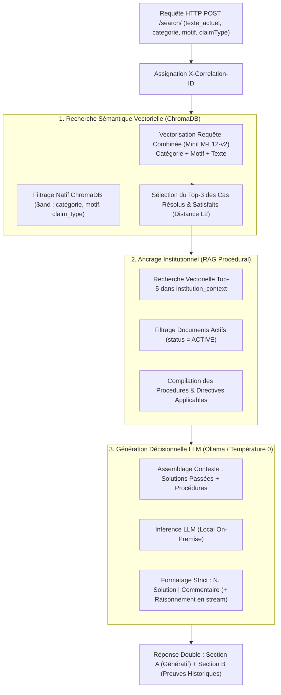
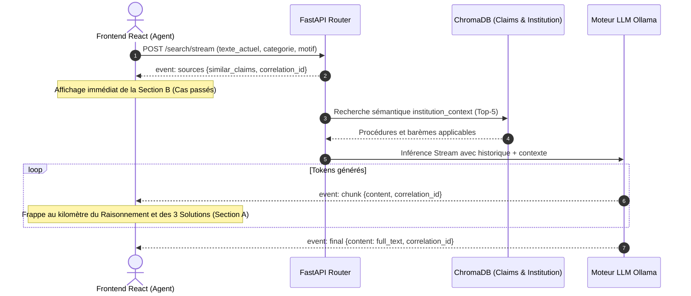

# 🔬 Spécification Détaillée : Pipeline de Recherche RAG & Copilote Agent (`/search`)

> **Module** : GPR AI Service (`gpr_ai_service`)  
> **Composants** : [`app/routers/search.py`](file:///c:/Users/HP/Desktop/Projets/GprWeb/gpr_web/gpr_ai/gpr_ai_service/app/routers/search.py), [`app/services/llm_service.py`](file:///c:/Users/HP/Desktop/Projets/GprWeb/gpr_web/gpr_ai/gpr_ai_service/app/services/llm_service.py), [`app/services/vector_service.py`](file:///c:/Users/HP/Desktop/Projets/GprWeb/gpr_web/gpr_ai/gpr_ai_service/app/services/vector_service.py)  
> **Version** : 2.0  
> **Statut** : En production / Référentiel technique  

---

## 1. 🎯 Vision Métier & Rôle dans l'Architecture GPR

La pipeline `/search` concrétise le **Module 2 (Traitement & Copilote Agent)** de la couche IA de GPR. Lors de l'instruction et de la prise en charge effective d'une réclamation ou d'une dénonciation par un gestionnaire bancaire, ce service assiste l'agent en combinant :
* **Preuve par le passé (Section B - Sources historiques)** : Extraction vectorielle des 3 réclamations passées les plus proches ayant abouti à une résolution validée et satisfaisante.
* **Génération de solutions personnalisées (Section A - Recommandations IA)** : Rédaction assistée de 3 propositions distinctes d'actions et de réponses client, articulées sous la forme stricte `Solution | Commentaire`.
* **Ancrage réglementaire et procédural** : Injection automatique des politiques, barèmes et procédures en vigueur dans la banque via une base vectorielle institutionnelle (`institution_context`).
* **Boucle d'apprentissage fermée (*Closed-Loop Feedback*)** : Seuls les dossiers formellement validés ou corrigés par les agents (`VALIDATED` / `CORRECTED`) alimentent la mémoire vectorielle.
* **Postulat *Human-in-the-Loop*** : L'IA ne valide ni n'envoie aucune solution de façon autonome. L'agent sélectionne, adapte ou rejette la proposition.

---

## 2. 🏗️ Architecture Globale & Flux de Traitement RAG



---

## 3. 🔌 Contrats d'Interface & Endpoints

### 3.1 Endpoint Synchrone : `POST /search/`

#### Schéma de la Requête (`SearchRequest`)
```json
{
  "texte_actuel": "Le GAB de l'agence principale a débité 100 000 FCFA de mon compte sans me délivrer les billets.",
  "categorie": "MONÉTIQUE ET CARTES",
  "motif": "DÉBIT SANS DÉLIVRANCE DE BILLETS",
  "gravite_max": "GRAVE",
  "claimType": "RECLAMATION"
}
```
* `categorie`, `motif`, `gravite_max` et `claimType` sont optionnels et permettent un ciblage contextuel précis.

#### Schéma de la Réponse JSON
```json
{
  "message": "1. Procéder au crédit immédiat à titre conservatoire | Cas avéré de débit sans délivrance confirmé par les logs GAB.\n2. Lancer la réconciliation comptable avec le transporteur de fonds | Nécessaire pour valider le solde physique du distributeur.\n3. Délivrer une attestation d'incident et renouveler la carte sans frais | Geste commercial suite au désagrément subi par le client.",
  "resultats_trouves": 3,
  "similar_claims": [
    {
      "score_similarite": 0.1842,
      "id_historique": 1042,
      "code": "REC-2026-0891",
      "code_client": "CLI-55421",
      "categorie": "monétique et cartes",
      "statut": "SATISFIED",
      "texte_original": "J'ai tenté de retirer 100 000 FCFA hier au GAB, le distributeur a fait du bruit sans me donner l'argent mais mon compte a été débité.",
      "solution_suggeree": "Recherche des logs physiques de la machine, constat de l'écart de caisse de 100 000 FCFA, puis rétrocession des fonds sous 24h avec notification SMS.",
      "modalite_depot": "GUICHET",
      "motif_reclamation": "débit sans délivrance de billets",
      "produit_service": "CARTE VISA NATIONALE",
      "point_service_indexe": "AGENCE PRINCIPALE",
      "date_creation": "2026-03-12T10:15:00",
      "medias": [],
      "audios": []
    }
  ],
  "correlation_id": "c1f79a24-118e-4a62-b91f-13a829f032aa"
}
```

* **Section A (Front-end)** : Champ `message` contenant les 3 options formulées pour l'agent.
* **Section B (Front-end)** : Liste `similar_claims` affichant les cartes d'éléments probants avec leur `score_similarite` ($L_2$).

---

### 3.2 Endpoint Réactif / Streaming : `POST /search/stream`

Permet d'envoyer immédiatement au frontend les cas historiques (Section B) pour affichage instantané, puis de diffuser token par token la proposition rédigée par le LLM (Section A) :



---

## 4. ⚙️ Les 4 Piliers Algorithmiques Détaillés

### Pilier 1 — Éligibilité & Ingestion des Cas Historiques

Tous les dossiers de la banque ne sont pas injectés aveuglément dans l'index RAG. L'ingestion ([`vector_service.py`](file:///c:/Users/HP/Desktop/Projets/GprWeb/gpr_web/gpr_ai/gpr_ai_service/app/services/vector_service.py#L90-L167)) applique un **filtre de confiance et de qualité strict** :

1. **Validation formelle par un agent** :
   ```python
   feedback_status = str(row.get("aiFeedbackStatus", "")).upper()
   if feedback_status not in {"VALIDATED", "CORRECTED"}:
       continue
   ```
   *Seules les réclamations où un agent humain a approuvé la solution ou l'a corrigée manuellement sont éligibles.*
2. **Présence d'une solution probante** :
   Le dossier doit contenir une solution confirmée (`texte_solution` ou `aiRetainedSolution`).
3. **Cas de test / Initialisation (Mock data)** :
   En l'absence de base synchronisée, le fallback ne charge que les dossiers ayant un statut `statut_final == 'SATISFIED'` ou relevant des dénonciations traitées.
4. **Format du document vectorisé** :
   $$\text{document} = \text{"Catégorie: \{cat\}. Motif: \{motif\}. Plainte: \{texte\}"}$$
   *Vectorisé en batch via `SentenceTransformer('paraphrase-multilingual-MiniLM-L12-v2')`.*

---

### Pilier 2 — Recherche Sémantique Vectorielle Filtrée

La méthode [`search_similar`](file:///c:/Users/HP/Desktop/Projets/GprWeb/gpr_web/gpr_ai/gpr_ai_service/app/services/vector_service.py#L183-L267) interroge la collection ChromaDB `claims` :

1. **Requête sémantique composite** :
   ```python
   combined_query = f"Catégorie: {category_filter or ''}. Motif: {motif_filter or ''}. Plainte: {query}"
   ```
   L'adjonction de la catégorie et du motif amplifie la pertinence vectorielle dans l'espace multidimensionnel (384 dimensions).
2. **Clause de filtrage natif ChromaDB (`where`)** :
   * Si la catégorie est fournie : `{"categorie": category_filter.lower()}`.
   * Si le motif est fourni : `{"motif_reclamation": motif_filter.lower()}`.
   * Si le type est fourni : `{"claim_type": claim_type_filter}`.
   * Si plusieurs critères sont présents : composition avec l'opérateur `{"$and": [...]}`.
3. **Métrique de score** :
   Distance euclidienne $L_2$ retournée par ChromaDB.
   * Plus la distance est proche de **$0.0$**, plus la similarité sémantique est forte.

---

### Pilier 3 — Ancrage Institutionnel & Procédures (`institution_context`)

Pour éviter que le LLM n'invente des compensations financières ou des gestes commerciaux contraires aux règles internes de l'établissement, la fonction [`_institution_context_text`](file:///c:/Users/HP/Desktop/Projets/GprWeb/gpr_web/gpr_ai/gpr_ai_service/app/services/llm_service.py#L32-L40) interroge la collection vectorielle dédiée `institution_context` :

* **Recherche vectorielle** : Extraction des $k=5$ documents de politique interne les plus pertinents avec le filtre `{"status": "ACTIVE"}`.
* **Format injecté** :
  ```text
  - Titre Document : Extrait du contenu procédural (limité à 2000 caractères)...
  ```
* Si aucun document n'est trouvé, la mention suivante est transmise : `"Aucun document institutionnel pertinent n'a été trouvé."`

---

### Pilier 4 — Génération Assistée Multi-Propositions (Section A)

Le LLM local (ex: `llama3.2:1b` ou modèle configuré) synthétise l'historique et les procédures pour produire une réponse structurée :

* **Règles rédactionnelles strictes** :
  1. Produire **exactement 3 options variées** (ex: solution standard, solution alternative, geste commercial/escalade).
  2. Chaque option doit comporter l'action proposée et sa justification pour l'agent, séparées par une barre verticale :
     $$\text{N. [Solution] | [Commentaire]}$$
  3. Ton professionnel avec vouvoiement, sans jamais mentionner la condition d'IA.
  4. En mode streaming, formulation préalable obligatoire d'une ligne d'analyse de situation préfixée par `RAISONNEMENT :`.

---

## 5. 📜 Prompts Utilisés dans la Pipeline (In Extenso)

### 5.1 Mode Synchrone : `generate_solution_from_history`

#### A. Prompt Système
```text
Tu es un assistant expert pour le service client de GPR (Gestion des Réclamations).
Ton rôle est d'analyser une plainte actuelle et les solutions historiques fournies.
Tu dois rédiger EXACTEMENT 3 propositions distinctes, numérotées 1, 2 et 3.
Chaque proposition doit être composée d'une SOLUTION (ce qu'on fait) et d'un COMMENTAIRE court (justification pour l'agent), séparés par le caractère '|'.

Règles strictes :
- Propose 3 options variées basées sur les données fournies.
- Format par ligne : "N. [Solution] | [Commentaire]"
- Reste courtois et professionnel (vouvoiement).
- Ne mentionne pas que tu es une IA.
- Exemple : "1. Rembourser les frais | Le client a été débité deux fois par erreur."
```

#### B. Template du Prompt Utilisateur Dynamique
```text
Plainte actuelle du client :
"{current_complaint_text}"

Voici comment des plaintes similaires ont été résolues par nos agents par le passé :
{context_text}

Contexte institutionnel et procédures applicables :
{institution_context}

Rédige maintenant les 3 propositions (Solution | Commentaire) idéales pour cette plainte.
```

* **Paramètres Ollama** : `temperature=0`.

---

### 5.2 Mode Streaming Réactif : `generate_solution_from_history_stream`

#### A. Prompt Système
```text
Tu es un assistant expert pour le service client de GPR (Gestion des Réclamations).
Ton rôle est d'analyser une plainte actuelle et les solutions historiques fournies.

Règles strictes :
- Rédige d'abord une courte analyse (raisonnement) en 1 ou 2 phrases de la situation, préfixée EXACTEMENT par "RAISONNEMENT :".
- Ensuite, propose EXACTEMENT 3 options variées basées sur les données fournies, numérotées 1, 2 et 3.
- Format par ligne pour chaque proposition : "N. [Solution] | [Commentaire]"
- Reste courtois et professionnel (vouvoiement).
- Ne mentionne pas que tu es une IA.

Exemple de réponse attendue :
RAISONNEMENT : Le client a subi un prélèvement injustifié suite à une erreur technique du système. Les solutions historiques privilégient un remboursement rapide.
1. Rembourser les frais | Le client a été débité deux fois par erreur.
2. ...
```

#### B. Template du Prompt Utilisateur Dynamique
```text
Plainte actuelle du client :
"{current_complaint_text}"

Voici comment des plaintes similaires ont été résolues par nos agents par le passé :
{context_text}

Contexte institutionnel et procédures applicables :
{institution_context}

Rédige maintenant les 3 propositions (Solution | Commentaire) idéales pour cette plainte.
```

* **Paramètres Ollama** : `temperature=0`, `stream=True`.

---

### 5.3 Format Réel des Variables Injectées Dynamiquement

#### Variable `{context_text}` (Solutions passées extraites de ChromaDB) :
```text
- Historique 1 : Constat d'anomalie DAB confirmé, rétrocession de 100 000 FCFA sur le compte sous 24h avec dispense de frais d'agios.
- Historique 2 : Demande d'expertise auprès du centre monétique régional et blocage temporaire des pénalités de découvert.
- Historique 3 : Recrédit direct après confirmation par le télé-affichage du journal électronique de l'automate.
```

#### Variable `{institution_context}` (Directives internes extraites de ChromaDB) :
```text
- Procédure de Traitement des Incidents Monétiques GAB : Tout écart de caisse constaté sur un automate de l'agence donne lieu à une régularisation automatique au profit du porteur dans un délai maximum de 48 heures ouvrées...
- Politique d'Indemnisation Commerciale : Les frais d'opposition ou de réémission consécutifs à un dysfonctionnement de nos équipements sont intégralement pris en charge par l'agence de rattachement...
```

---

## 6. 📊 Événements Server-Sent Events (SSE) en Mode Streaming

Lors de l'appel à `POST /search/stream`, le client reçoit les événements suivants :

| Ordre | Événement (`type`) | Payload Exemple | Rôle & Affichage Front-end |
| :---: | :--- | :--- | :--- |
| **1** | `sources` | `{"type": "sources", "similar_claims": [...], "correlation_id": "uuid"}` | **Section B immédiate** : affiche les cartes des 3 cas passés avec détails et score $L_2$. |
| **2** | `chunk` | `{"type": "chunk", "content": "RAISONNEMENT : Le client...", "correlation_id": "uuid"}` | **Section A progressive** : diffuse la frappe en temps réel du raisonnement puis des 3 options. |
| **3** | `final` | `{"type": "final", "content": "RAISONNEMENT : ...\n1. ...\n2. ...\n3. ...", "correlation_id": "uuid"}` | Consolidation finale du texte complet pour persistance dans le state React. |

*Cas particulier* : Si aucun cas similaire n'est trouvé dans la base vectorielle, un événement `chunk` avec `"Aucune similarité trouvée dans l'histoire."` est immédiatement émis avant le `final`.

---

## 7. 🔒 Sécurité, Robustesse & Boucle d'Apprentissage

* **Absence d'Hallucination Débridée** : Le conditionnement du prompt par les cas passés réels et les procédures institutionnelles encadre strictement la liberté du LLM.
* **Tolérance aux Pannes** : Si Ollama ou le modèle LLM est inaccessible, le endpoint synchrone renvoie un message d'erreur clair tout en conservant intacts les cas historiques (`similar_claims`), garantissant que l'agent dispose toujours de ses sources d'information pour statuer.
* **Protection des Données Personnelles** : Les solutions historiques indexées sont anonymisées lors de la synchronisation (seules la typologie, la description factuelle et la solution appliquée sont conservées dans le vecteur d'embedding).
