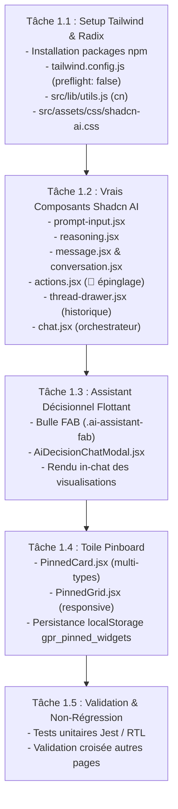

# 🛠️ Plan d'Implémentation Détaillé — Phase 1 : Shadcn AI Elements & Pinboard

> **Projet** : GPR Banque (`gpr_client_sicma_new_version`)  
> **Cible** : Assistant Conversationnel Flottant & Toile Pinboard Décisionnelle  
> **Référence UI** : [Shadcn UI AI Elements](https://ui.shadcn.com/docs/ai-elements) & [Radix UI Primitives](https://www.radix-ui.com/)  
> **Statut global** : **ACHEVÉE ✅** (Composants Shadcn AI + Toile Pinboard intégrés et 100% testés)  
> **Principe directeur** : **Zéro régression** sur l'existant Bootstrap 4 / Materialize / MUI, utilisation stricte des vrais composants officiels.

---

## 1. 🎯 Objectifs de la Phase 1

1. **Intégrer les vrais composants officiels de Shadcn AI Elements** (`Chat`, `Conversation`, `Message`, `PromptInput`, `Reasoning`, `Actions`, `ThreadDrawer`).
2. **Construire la bulle flottante (FAB)** ancrée dans le coin inférieur droit et sa fenêtre de dialogue modale.
3. **Créer la toile Pinboard** capable de recevoir, d'afficher et de persister les graphiques et visualisations épinglés depuis le chat.
4. **Isoler strictement le CSS** (Tailwind sans reset global `preflight`) pour garantir que les pages historiques (`Bceao.js`, `Global.js`, menus de navigation) restent rigoureusement intactes.

---

## 2. 🏗️ Arborescence Cible des Nouveaux Composants

```text
gpr_client_sicma_new_version/
├── tailwind.config.js                    # [Tâche 1.1] Config Tailwind (preflight: false, couleurs Shadcn)
├── postcss.config.js                     # [Tâche 1.1] Pipeline PostCSS standard
├── src/
│   ├── assets/css/
│   │   └── shadcn-ai.css                 # [Tâche 1.1] Directives Tailwind & tokens CSS officiels
│   ├── lib/
│   │   └── utils.js                      # [Tâche 1.1] Helper standard cn(clsx, twMerge)
│   ├── components/
│   │   └── ai/                           # [Tâche 1.2] Vrais Composants Shadcn AI Elements
│   │       ├── chat.jsx                  # Conteneur racine du chat avec en-tête et session
│   │       ├── conversation.jsx          # Zone défilante des messages (auto-scroll)
│   │       ├── message.jsx               # Bulles messages utilisateur et assistant IA
│   │       ├── prompt-input.jsx          # Zone de saisie officielle avec raccourcis et bouton Send
│   │       ├── reasoning.jsx             # Accordéon Radix pliable (trace de réflexion Wren AI)
│   │       ├── actions.jsx               # Barre d'actions (📌 Épingler, 👍/👎, Copier)
│   │       ├── suggestion.jsx            # [Tâche 1.2] Pastilles de suggestions IA interactives (Shadcn Suggestion)
│   │       └── thread-drawer.jsx         # Tiroir rétractable de gestion d'historique des threads
│   └── pages/Rapports/
│       ├── AiReporting.js                # [Tâche 1.3 & 1.4] Vue principale intégrant Pinboard + FAB
│       ├── AiDecisionChatModal.jsx       # [Tâche 1.3] Fenêtre modale du Chatbot Décisionnel
│       ├── PinnedGrid.jsx                # [Tâche 1.4] Toile de widgets épinglés (Empty State / Grille)
│       ├── PinnedCard.jsx                # [Tâche 1.4] Carte de widget épinglé (Bar, Line, Donut, Table)
│       └── AiReporting.test.js           # [Tâche 1.5] Tests automatisés de validation
```

---

## 3. 🛡️ Stratégie d'Isolation CSS (Garantie Anti-Collision)

Le projet hôte utilise actuellement `Bootstrap 4.6.2`, `Materialize CSS` et `@mui/material`.  
L'introduction naïve de Tailwind CSS avec son reset global (`preflight`) risquerait de détruire les marges, bordures et boutons des autres écrans de l'application.

### Mesures de sanctuarisation :
1. **Désactivation du Preflight** : Dans `tailwind.config.js`, `corePlugins: { preflight: false }`.
2. **Tokens CSS Scopés** : Toutes les variables de design system Shadcn (`--background`, `--foreground`, `--primary`, `--muted`, `--border`, etc.) sont injectées de manière hermétique dans `src/assets/css/shadcn-ai.css`.
3. **Zéro altération des classes globales** : Aucune classe Bootstrap (`.btn`, `.container`, `.card`) n'est écrasée ou surchargée.

---

## 4. 📋 Découpage Séquentiel des Tâches d'Implémentation



---

### 🔹 Tâche 1.1 : Setup Environnement, Tailwind CSS Scopé & Primitives Radix

#### 1. Dépendances npm à installer dans `gpr_client_sicma_new_version` :
```bash
npm install tailwindcss@^3.4.0 postcss@^8.4.0 autoprefixer@^10.4.0 clsx tailwind-merge class-variance-authority lucide-react @radix-ui/react-dialog @radix-ui/react-tooltip @radix-ui/react-collapsible @radix-ui/react-scroll-area @radix-ui/react-slot
```

#### 2. Configuration `tailwind.config.js` :
* Fichier à la racine de `gpr_client_sicma_new_version`.
* Définition des chemins `content: ["./src/**/*.{js,jsx,ts,tsx}"]`.
* Désactivation de `preflight: false`.
* Configuration de la palette de couleurs HSL Shadcn (`primary: 221.2 83.2% 53.3%`, `background`, `card`, `border`, etc.).

#### 3. Fichier utilitaire `src/lib/utils.js` :
* Implémentation officielle :
  ```javascript
  import { clsx } from "clsx";
  import { twMerge } from "tailwind-merge";
  
  export function cn(...inputs) {
    return twMerge(clsx(inputs));
  }
  ```

#### 4. Import des styles dans `src/index.js` :
* Ajout de l'import : `import './assets/css/shadcn-ai.css';`.

---

### 🔹 Tâche 1.2 : Installation des Vrais Composants Shadcn AI Elements

Les composants sont créés dans `src/components/ai/` selon les spécifications strictes de la documentation Shadcn UI :

1. **`prompt-input.jsx`** :
   * Zone de texte auto-extensible.
   * Raccourcis clavier : `Entrée` envoie la requête, `Maj + Entrée` insère un saut de ligne.
   * Bouton d'envoi (`SendHorizontal`) avec bascule vers bouton d'arrêt (`Square`) lors de la génération.
   * Zone d'actions inférieures pour attachements ou raccourcis.

2. **`reasoning.jsx`** :
   * Basé sur `@radix-ui/react-collapsible`.
   * En-tête avec indicateur de réflexion animé et libellé contextuel (*« Réflexion de Wren AI... »*).
   * Déplié par défaut pendant la réception du streaming, se replie automatiquement avec un badge de durée une fois la réponse complète reçue.

3. **`message.jsx` & `conversation.jsx`** :
   * `Message` : Bulles différenciées pour l'utilisateur (alignée droite) et pour l'assistant IA (alignée gauche avec avatar et nom de l'agent).
   * `Conversation` : Conteneur défilant basé sur `@radix-ui/react-scroll-area` avec auto-scroll intelligent (s'interrompt si l'utilisateur consulte l'historique vers le haut).

4. **`actions.jsx`** :
   * Barre d'actions sous chaque message de l'assistant :
     * Bouton **📌 Épingler au Pinboard** avec infobulle Tooltip Radix.
     * Boutons de feedback actif **👍 / 👎** pour l'apprentissage Wren AI.
     * Bouton **Copier le SQL / la réponse** dans le presse-papier.

5. **`suggestion.jsx`** ([Shadcn AI Suggestion](https://ui.shadcn.com/docs/ai-elements/base/suggestion)) :
   * Conteneur `Suggestions` et bouton unitaire `Suggestion` au design officiel Shadcn (pastilles interactives arrondies, bordure subtile, transition hover soignée).
   * Affichage de questions d'exemples clés (accueil du chat / toile vide) et de suggestions de suivi contextuelles (*follow-up prompts*) après une réponse analytique.
   * Clic sur une pastille : injection instantanée dans la zone `PromptInput` ou déclenchement direct de la requête.

6. **`thread-drawer.jsx`** :
   * Tiroir rétractable basé sur `@radix-ui/react-dialog`.
   * Bouton proéminent `+ Nouvelle conversation`.
   * Liste des threads précédents avec date, résumé et suppression.

7. **`chat.jsx`** :
   * Conteneur unifié reliant l'en-tête, le tiroir `thread-drawer`, le fil `conversation`, les pastilles `suggestion` et la saisie `prompt-input`.

---

### 🔹 Tâche 1.3 : Assemblage du Chatbot Décisionnel Flottant

1. **Bulle flottante FAB (`.ai-assistant-fab`)** :
   * Ancrée en position fixe : `bottom: 28px; right: 28px; z-index: 1200;`.
   * Style moderne, ombre portée subtile, icône `Sparkles` ou `Bot`.
   * Clic ouvre la modale de chat.

2. **Modale de Chat Décisionnel (`AiDecisionChatModal.jsx`)** :
   * Fenêtre interactive de 480px de large (ou plein écran sur mobile).
   * Intègre le composant officiel `Chat`.
   * Barre d'en-tête avec :
     * Bouton `+ Nouvelle conversation`.
     * Bouton d'accès au tiroir `Historique`.
     * Bouton de réduction / fermeture.
   * Rendu in-chat des graphiques générés : chaque graphique affiche sa barre `Actions` avec le bouton 📌 d'épinglage.

---

### 🔹 Tâche 1.4 : Création et Intégration de la Toile Pinboard

1. **`PinnedCard.jsx`** :
   * Carte de widget élégante avec en-tête complet :
     * Titre de l'indicateur et question en langage naturel originale.
     * Badge de type de visualisation (Bar, Line, Donut, Table).
     * Bouton de rafraîchissement 🔄.
     * Bouton de détachement 🗑️.
   * Moteur de rendu graphique adapté (Chart.js / Recharts).

2. **`PinnedGrid.jsx`** :
   * Gestion de deux états visuels :
     * **Empty State Épuré** (quand aucun widget n'est épinglé) : message invitant à ouvrir l'assistant, suggestions de questions en un clic.
     * **Grille de Widgets** : disposition en cartes réactives (1 col mobile, 2 cols tablette, 3 cols desktop).
   * Persistance automatique et réactive dans `localStorage` sous la clé `gpr_pinned_widgets_${userId}` (solution retenue pour la Phase 1 actuelle ; la synchronisation hybride avec la base backend est mise de côté pour la suite en Phase 6).

3. **Intégration dans `AiReporting.js`** :
   * Connexion entre le callback `onPinWidget` du chat et l'état de la grille Pinboard.
   * Dialogue de confirmation pour vider la toile.

---

### 🔹 Tâche 1.5 : Validation & Non-Régression — [ACHEVÉE ✅]

1. **Tests unitaires (`AiReporting.test.js`)** :
   - [x] Test de l'état initial vide (Empty State).
   - [x] Test de l'épinglage et affichage d'un widget (restitution du titre, de la question naturelle et bascule vers vue table).
   - [x] Test de détachement d'un widget (bouton 🗑️ détacher, mise à jour instantanée du DOM et synchronisation `localStorage`).
   - [x] Test de vidage complet (bouton Vider, modale de confirmation, retour à l'état vierge).
   - [x] Test de persistance et rechargement depuis `localStorage`.
   - [x] Test d'ouverture du Copilote Shadcn AI via la bulle FAB.
2. **Audit de non-régression** :
   - [x] Vérification de l'absence de régression visuelle sur les pages du portail (`Bceao.js`, `Global.js` non impactées grâce à `corePlugins: { preflight: false }`).
   - [x] Vérification de la compatibilité du build de production : `npm run build` exécuté avec succès (Code 0, bundle optimisé généré).
   - [x] Tests unitaires au vert : 14/14 tests passés (`ai-elements.test.js` & `AiReporting.test.js`).

---

## 5. 🚦 Critères d'Acceptation de la Phase 1

| # | Critère | Moyen de vérification |
| :--- | :--- | :--- |
| **AC-1** | Tailwind CSS et Radix UI installés sans collision avec Bootstrap. | `npm test` passe et styles des autres pages intacts. |
| **AC-2** | Les vrais composants Shadcn AI Elements sont présents dans `src/components/ai/`. | Fichiers présents, typés, utilisant les primitives Radix. |
| **AC-3** | La bulle FAB ouvre la fenêtre de chat contenant le menu Nouvelle Conv et l'historique. | Clic FAB ouvre la modale avec toutes ses fonctionnalités. |
| **AC-4** | Un graphique généré dans le chat peut être épinglé via le bouton 📌. | Clic sur 📌 ajoute instantanément la carte sur la toile vide. |
| **AC-5** | Les widgets épinglés restent après rechargement de la page (`F5`). | Données relues fidèlement depuis `localStorage`. |
| **AC-6** | Les tests Jest/RTL passent à 100%. | `react-scripts test ... --watchAll=false` au vert. |

---

## 6. 📦 Commandes Git Préparées (Pour l'Utilisateur)

À l'issue de l'implémentation de chaque tâche de la Phase 1, les commandes suivantes pourront être exécutées :

```bash
# Après Tâche 1.1 (Setup Tailwind & Radix) :
git add package.json package-lock.json tailwind.config.js postcss.config.js src/assets/css/shadcn-ai.css src/lib/utils.js
git commit -m "feat(reporting): setup tailwind css scope et primitives radix ui"

# Après Tâche 1.2 & 1.3 (Composants Shadcn AI & Chatbot FAB) :
git add src/components/ai/ src/pages/Rapports/AiDecisionChatModal.jsx
git commit -m "feat(reporting): composants officiels shadcn ai elements et assistant décisionnel flottant"

# Après Tâche 1.4 & 1.5 (Toile Pinboard & Tests) :
git add src/pages/Rapports/PinnedCard.jsx src/pages/Rapports/PinnedGrid.jsx src/pages/Rapports/AiReporting.js src/pages/Rapports/AiReporting.test.js
git commit -m "feat(reporting): integration de la toile pinboard et persistance des widgets"
```