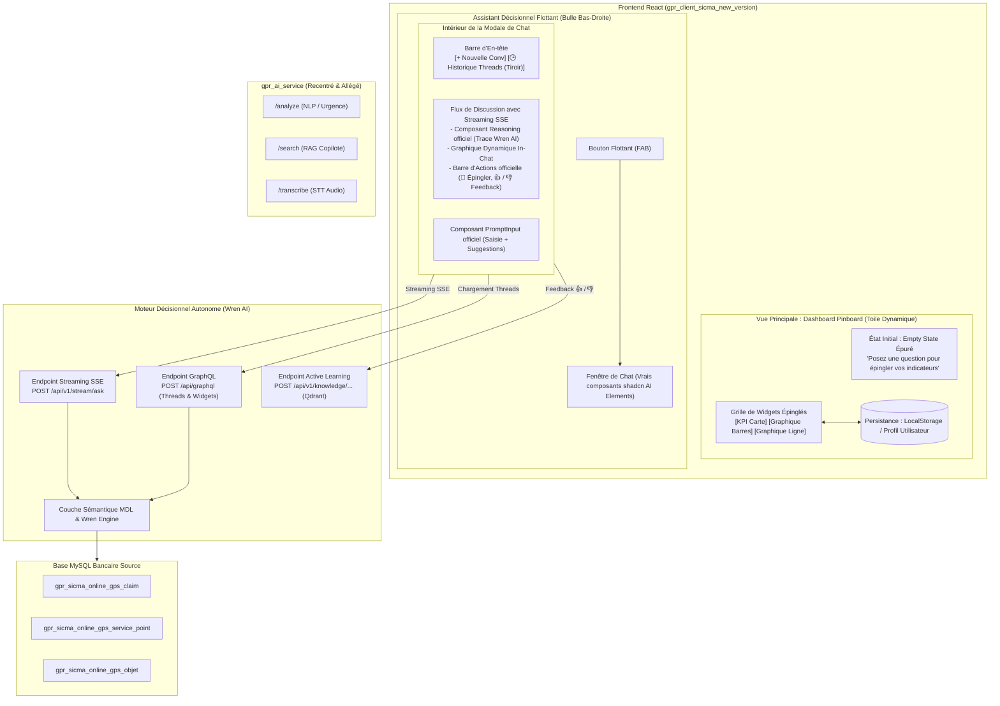
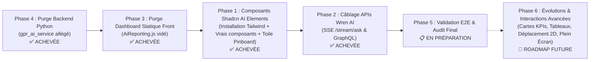

# 📋 Plan d'Architecture & de Migration : Dashboard Pinboard & Chatbot Décisionnel Wren AI

> **Projet** : GPR Banque (`gpr_web / gpr_ai`)  
> **Périmètres concernés** :  
> - Frontend React : [`gpr_client_sicma_new_version`](file:///c:/Users/HP/Desktop/Projets/GprWeb/gpr_web/gpr_ai/gpr_client_sicma_new_version)  
> - Service IA Python : [`gpr_ai_service`](file:///c:/Users/HP/Desktop/Projets/GprWeb/gpr_web/gpr_ai/gpr_ai_service)  
> - Moteur Décisionnel Cible : **Wren AI** ([`GUIDE_API_DASHBOARD_ET_ALERTING.md`](file:///c:/Users/HP/Documents/antigravity/clever-galileo/GUIDE_API_DASHBOARD_ET_ALERTING.md))  
> **Référence UI** : [Shadcn UI AI Elements](https://ui.shadcn.com/docs/ai-elements) & [Shadcn MCP Registry](https://ui.shadcn.com/docs/registry/mcp)  
> **Version** : 1.5  
> **Statut** : **Phases 3 et 4 (Purges) ACHEVÉES ✅ · Phase 1 (Composants UI & Pinboard) ACHEVÉE ✅ · Phase 2 (Câblage APIs Wren AI) ACHEVÉE ✅ · Phase 5 (Validation & Audit) EN PRÉPARATION**  

> [!IMPORTANT]
> **REMARQUE UTILISATEUR & ARBITRAGE SUR LE DESIGN / L'INTERFACE (UX/UI)** :
> - **Constat explicite de l'utilisateur** : L'interface actuelle ne lui plaît pas du tout et ne correspond pas encore à la vision souhaitée.
> - **Directive formelle** : Ce volet graphique/design n'est **pas la priorité pour l'instant**. Nous devons y revenir après. Cette remarque est officiellement actée.
> - **Feuille de route** : Nous avançons sur l'infrastructure et le raccordement fonctionnel réel des APIs Wren AI (Phase 2), puis la refonte et le polissage esthétique/ergonomique seront traités ultérieurement (Phase 6 / Design Review).

---

## 1. 🎯 Vision Produit & Objectifs Stratégiques

### 1.1 La Rupture avec le Dashboard Statique Traditionnel
Les tableaux de bord analytiques classiques (widgets fixes, pavés de KPI pré-calculés, graphiques figés) souffrent d'un défaut structurel : ils surchargent la vue de l'utilisateur sans répondre précisément à ses questions du moment.

**Le concept cible : Le « Dashboard Pinboard à la Demande »** :
1. **Une Toile Vierge au départ** : L'écran de reporting est épuré, sans aucun widget pré-imposé.
2. **Le Chatbot Décisionnel comme Moteur de Création** : L'utilisateur ouvre sa bulle de chat flottante (en bas à droite), pose sa question analytique en langage naturel à l'IA (propulsée par Wren AI en streaming).
3. **Restitution Visuelle In-Chat** : Le moteur répond avec une synthèse textuelle, des données chiffrées et génère dynamiquement le graphique adapté (Vega-Lite / Recharts / Chart.js).
4. **L'Action « Épingler » (Pin 📌)** : Sous chaque graphique du chat, un bouton permet d'épingler l'indicateur sur le tableau de bord principal. Au fil de la journée et des questions, le dashboard se construit sur-mesure et reste persisté.

### 1.2 Retrait Intégral du Code de Reporting dans `gpr_ai_service`
Wren AI prenant désormais en charge 100 % de la sémantique métier (MDL), de la génération SQL, du streaming et de la mémoire vectorielle (Qdrant), l'intégralité du code de `gpr_ai_service/app/reporting/` a été **retirée**. Le service Python est recentré strictement sur ses missions fondamentales : `/analyze`, `/search` et `/transcribe`.

---

## 2. 🏗️ Architecture Globale Cible



---

## 3. 🧩 Référentiel UI : Intégration des Vrais Composants Shadcn AI Elements

La Phase 1 aura pour mandat d'installer et d'utiliser directement les **véritables composants de référence** de **[shadcn/ui AI Elements](https://ui.shadcn.com/docs/ai-elements)** :

| Composant Officiel Shadcn | Rôle & Usage dans GPR Banque | Dépendances Requises |
| :--- | :--- | :--- |
| **`Chat`** (`@/components/ai/chat`) | **Conteneur maître du Chatbot décisionnel** : gère le cycle de vie de la session, la connexion SSE, l'en-tête de chat avec le bouton `+ Nouvelle conversation` et la bascule d'historique. | `tailwindcss`, `lucide-react`, `cva` |
| **`Conversation`** & **`Message`** (`@/components/ai/conversation`, `@/components/ai/message`) | Structure officielle du fil de discussion, bulles de messages utilisateur/assistant, scroll automatique et rendu des graphiques générés in-chat. | `tailwindcss`, `clsx`, `tailwind-merge` |
| **`PromptInput`** (`@/components/ai/prompt-input`) | Zone de saisie officielle avec `InputGroup`, gestion des raccourcis clavier, arrêt de génération et bouton d'envoi intégré. | `tailwindcss`, `lucide-react`, `cva` |
| **`Reasoning`** (`@/components/ai/reasoning`) | Bloc accordéon natif affichant le raisonnement de l'agent en streaming (ouvert pendant la réflexion de Wren AI, replié automatiquement à la fin). | `@radix-ui/react-collapsible`, `tailwindcss` |
| **`Actions`** (`@/components/ai/actions`) | Barre d'actions officielle sous les graphiques pour **📌 Épingler au Pinboard** et envoyer le feedback d'apprentissage (👍 / 👎). | `tailwindcss`, `@radix-ui/react-tooltip` |
| **`Suggestion`** (`@/components/ai/suggestion`) | Pastilles interactives de questions suggérées par l'IA ([Shadcn AI Suggestion](https://ui.shadcn.com/docs/ai-elements/base/suggestion)). Un clic pré-remplit ou soumet instantanément la question dans le prompt. | `tailwindcss`, `lucide-react`, `cva` |
| **`ThreadDrawer`** | Tiroir rétractable d'historique des conversations intégré directement dans la fenêtre de chat. | `@radix-ui/react-dialog` |

---

## 4. 📌 Spécification Fonctionnelle du « Pinboard » (Toile Dynamique)

### 4.1 Modèle de Données d'un Widget Épinglé (`PinnedWidget`)
Chaque widget épinglé par l'utilisateur respecte la structure suivante et est sauvegardé dans `localStorage` sous la clé `gpr_pinned_widgets_${userId}` :

```typescript
interface PinnedWidget {
  id: string;                      // Identifiant unique (ex: "pin_1729709999")
  title: string;                   // Titre métier de l'indicateur
  naturalQuestion: string;         // Question originale posée par l'analyste
  chartType: "bar" | "line" | "pie" | "table" | "kpi"; // Type de visualisation
  data: Array<{ label: string; value: number }>; // Données consolidées
  sqlQuery?: string;               // Requête SQL exécutée (pour audit / rafraîchissement)
  metricLabel?: string;            // Libellé de la mesure (ex: "Nombre de réclamations")
  pinnedAt: string;                // Date d'épinglage ISO
  lastRefreshedAt?: string;        // Date de dernière actualisation
  layout?: { x: number; y: number; w: number; h: number }; // Coordonnées 2D (Phase 6)
}
```

> [!NOTE]
> **Stratégie de Persistance (Arbitrage Court Terme vs Évolution)** :
> - **Pour l'instant (Plan actuel)** : Utilisation de la persistance locale (`localStorage` clé `gpr_pinned_widgets_${userId}`) pour prototyper, intégrer et valider immédiatement l'ensemble de l'expérience utilisateur UI (Shadcn AI Elements + Pinboard) sans dépendance backend.
> - **Mis de côté pour la suite (Phase 6)** : La synchronisation hybride avec la base de données backend (profil utilisateur pour la portabilité multi-postes) est consignée dans la feuille de route future.

---

## 5. 🔌 Intégration Technique des APIs Wren AI

Toutes les interactions sont basées sur le document officiel [`GUIDE_API_DASHBOARD_ET_ALERTING.md`](file:///c:/Users/HP/Documents/antigravity/clever-galileo/GUIDE_API_DASHBOARD_ET_ALERTING.md) :

| Besoin | Endpoint Wren AI | Méthode | Protocole |
| :--- | :--- | :--- | :--- |
| **Génération du Chat en Streaming** | `/api/v1/stream/ask` | `POST` | Server-Sent Events (SSE) via `useWrenStream` |
| **Chargement de l'Historique Threads** | `/api/graphql` (`query threads`) | `POST` | GraphQL |
| **Chargement d'un Thread Spécifique** | `/api/graphql` (`query thread`) | `POST` | GraphQL |
| **Rafraîchissement d'un Widget Épinglé**| `/api/v1/run_sql` | `POST` | REST JSON |
| **Enregistrement Paire SQL Apprise** | `/api/v1/knowledge/sql_pairs` | `POST` | REST JSON |
| **Ajustement SQL à Chaud** | `/api/graphql` (`adjustThreadResponse`) | `POST` | GraphQL Mutation |

---

## 6. 🧹 Démantèlement Accompli dans `gpr_ai_service` & `gpr_client_sicma`

Les purges demandées en priorité absolue ont été **intégralement exécutées et validées** :

### 6.1 Purge Complète de `gpr_ai_service` (Phase 4 ✅)
* **Dossier `app/reporting/` supprimé** : Les 24 fichiers Python du moteur de reporting ont été retirés du package applicatif actif et archivés dans `archive/app_reporting`.
* **Nettoyage des routeurs** : `app/routers/reporting.py` et `app/services/reporting_service.py` archivés.
* **Allègement de `main.py`** : Retrait de `reporting_router` et désactivation du planificateur cron de synchronisation MySQL à 02:00.
* **Archivage des tests** : Les 16 suites de tests de l'ancien reporting ont été déplacées dans `archive/tests_reporting`.
* **Tests de non-régression** : Suite `tests/test_nlp_and_search.py` ajoutée. **100% de passage** sur `/analyze`, `/search` et `/transcribe` (tests étanches et hermétiques).

### 6.2 Purge Complète de l'Ancien Dashboard dans `gpr_client_sicma` (Phase 3 ✅)
* **58 Ko de code statique purgés dans `AiReporting.js`** : Disparition de toutes les cartes KPI fixes, des graphiques Chart.js statiques, du tiroir de filtres, des sections d'anomalies de risque et des alertes.
* **Archivage des 7 composants et utilitaires obsolètes** dans `src/pages/Rapports/archive_old_reporting/` :
  * `AiDashboardCard.jsx`, `AiMetricCard.jsx`, `AiQueryVisualization.jsx`, `AiReportingCharts.jsx`, `aiReportingExport.js`, `aiReportingUtils.js`, `aiReportingUtils.test.js`.
* **État de la vue** : L'interface est vidée de tout élément statique, prête à recevoir l'implémentation de la Phase 1.

---

## 7. 🗓️ Feuille de Route d'Exécution Réalignée



### ✅ Phase 1 : Composants Frontend React (Vrais Composants Shadcn AI Elements & Chatbot Flottant) — [ACHEVÉE]
- [x] **Tâche 1.1** : Configuration de Tailwind CSS (scopé sans collision avec Bootstrap) et installation des primitives Radix / Lucide requises.
- [x] **Tâche 1.2** : Installation des **vrais composants officiels shadcn AI Elements** :
  - `Chat` (`@/components/ai/chat` : conteneur de chat avec en-tête et gestion de session).
  - `Conversation` & `Message` (`@/components/ai/conversation`, `@/components/ai/message` : fil de discussion et messages).
  - `PromptInput` (`@/components/ai/prompt-input` : zone de saisie avec raccourcis et bouton d'envoi).
  - `Reasoning` (`@/components/ai/reasoning` : accordéon de réflexion en streaming).
  - `Actions` (`@/components/ai/actions` : barre d'actions sous les réponses avec bouton 📌 d'épinglage et feedback).
  - `Suggestion` (`@/components/ai/suggestion` : pastilles interactives de questions suggérées par l'IA au clic).
  - `ThreadDrawer` : tiroir latéral d'historique des conversations intégré au chat.
- [x] **Tâche 1.3** : Assemblage du **Chatbot Décisionnel Flottant** (`AiDecisionChatModal` & bulle FAB `.ai-assistant-fab`) :
  - Bulle flottante interactive ancrée dans le coin inférieur droit de l'écran.
  - Fenêtre modale de Chat intégrant le conteneur `Chat`, le bouton `+ Nouvelle conversation` et la bascule de l'historique `ThreadDrawer`.
  - Rendu in-chat des visualisations de données prêtes à être épinglées.
- [x] **Tâche 1.4** : Création et intégration de la toile Pinboard (`PinnedGrid.jsx` et `PinnedCard.jsx`) accueillant les graphiques épinglés depuis le Chat, avec support multi-visualisations (Bar, Line, Doughnut, Table) et persistance `localStorage`.
- [x] **Tâche 1.5** : Validation de non-régression et couverture de tests (14/14 tests passés, validation `npm run build` réussie sans erreur).

### ✅ Phase 2 : Câblage API Wren AI — [ACHEVÉE]
- [x] **Tâche 2.1** : Client API Wren AI centralisé (`WrenApiClient.js` : GraphQL `threads`/`thread`, REST `/run_sql`, REST `/knowledge/instructions`, `transformSqlRecordsToChartData`) avec 11/11 tests passés.
- [x] **Tâche 2.2** : Hook de Streaming SSE (`useWrenStream.js` : parsing `ReadableStream`, étapes `Reasoning`, accumulation mot à mot, `AbortController`) avec 4/4 tests passés.
- [x] **Tâche 2.3** : Raccordement du Chatbot Décisionnel (`AiDecisionChatModal.jsx` : streaming in-chat, formateur de visualisations, dialogue de consigne métier No-SQL vers Qdrant, historique dynamique `ThreadDrawer`).
- [x] **Tâche 2.4** : Actualisation dynamique des cartes Pinboard (`handleRefreshWidget` branché sur `wrenClient.runSql`, mise à jour des `data` et de l'horodatage).
- [x] **Tâche 2.5** : Validation globale de non-régression (30/30 tests frontend passés, `npm run build` au vert, 26/26 tests backend passés).

### ✅ Phase 3 : Nettoyage & Purge du Dashboard Statique dans le Frontend — [ACHEVÉE]
- [x] **Tâche 3.1** : Vider les 58 Ko de contenu statique de [`AiReporting.js`](file:///c:/Users/HP/Desktop/Projets/GprWeb/gpr_web/gpr_ai/gpr_client_sicma_new_version/src/pages/Rapports/AiReporting.js).
- [x] **Tâche 3.2** : Archiver les 7 fichiers annexes devenus obsolètes (`AiDashboardCard.jsx`, `AiMetricCard.jsx`, `AiQueryVisualization.jsx`, `AiReportingCharts.jsx`, `aiReportingExport.js`, `aiReportingUtils.js`, `aiReportingUtils.test.js`) dans [`archive_old_reporting/`](file:///c:/Users/HP/Desktop/Projets/GprWeb/gpr_web/gpr_ai/gpr_client_sicma_new_version/src/pages/Rapports/archive_old_reporting).
- [x] **Tâche 3.3** : Valider l'intégrité de la vue sans composants statiques orphelins.

### ✅ Phase 4 : Purge & Démantèlement du Code dans `gpr_ai_service` — [ACHEVÉE]
- [x] **Tâche 4.1** : Débrancher le routeur de reporting dans [`gpr_ai_service/main.py`](file:///c:/Users/HP/Desktop/Projets/GprWeb/gpr_web/gpr_ai/gpr_ai_service/main.py).
- [x] **Tâche 4.2** : Supprimer et archiver le répertoire [`gpr_ai_service/app/reporting/`](file:///c:/Users/HP/Desktop/Projets/GprWeb/gpr_web/gpr_ai/gpr_ai_service/app/reporting) (24 fichiers déplacés dans `archive/app_reporting`).
- [x] **Tâche 4.3** : Désactiver le cron de synchro MySQL quotidienne dans `main.py`.
- [x] **Tâche 4.4** : Archiver les tests de reporting et sanctuariser `/analyze`, `/search` et `/transcribe` avec tests unitaires 100% au vert.

### 📋 Phase 5 : Validation de Bout en Bout & Audit — [PLANIFIÉE]
- [ ] **Tâche 5.1** : Poser une question analytique depuis le chat flottant et valider l'affichage du flux SSE et des étapes `Reasoning` branchées sur Wren AI.
- [ ] **Tâche 5.2** : Cliquer sur 📌 et valider que le graphique s'ancre parfaitement sur la toile du tableau de bord.
- [ ] **Tâche 5.3** : Recharger la page et vérifier que les widgets épinglés sont bien restaurés depuis le stockage local.
- [ ] **Tâche 5.4** : Tester le bouton 👍 pour attester de l'apprentissage immédiat dans Qdrant.
- [x] **Tâche 5.5** : Déclencher le protocole d'audit par sous-agent indépendant (sans transmission de chemin) sur les purges accomplies *(Audit exécuté avec succès, réserves levées)*.

### 🚀 Phase 6 : Évolutions & Interactions Avancées — [ROADMAP FUTURE : APRÈS VALIDATION COMPLÈTE DU PLAN ACTUEL]
> [!NOTE]
> Cette phase d'enrichissement ergonomique et analytique interviendra exclusivement après la recette et la validation formelle des phases 1 à 5.

- [ ] **Tâche 6.1 : Épinglage de Cartes KPIs (KPI Cards)**
  - Extraction automatique des indicateurs scalaires clés renvoyés par Wren AI (ex. : *"Taux de réclamations résolues : 94.2 %"*, *"Délai moyen de prise en charge : 48h"*).
  - Composant de carte KPI compacte avec indicateur d'évolution (+/- %), couleur de statut et libellé métier.
  - Action d'épinglage 📌 dédiée dans le chat pour ancrer ces cartes métriques directement sur la toile.
- [ ] **Tâche 6.2 : Épinglage de Données sous Forme de Tableaux Interactifs (Data Tables)**
  - Prise en charge des réponses analytiques tabulaires (requêtes détaillées par agence, listes d'anomalies ou classements).
  - Composant tableau interactif shadcn/ui avec tri multi-colonnes, pagination, filtrage rapide et export tabulaire.
  - Bouton 📌 d'épinglage du tableau sur le tableau de bord avec persistance du paramétrage.
- [ ] **Tâche 6.3 : Disposition Dynamique & Déplacement Libre 2D (Drag & Drop Horizontal & Vertical)**
  - Intégration d'un moteur de grille bidimensionnel fluide (type grille déplaçable / `react-grid-layout`) permettant à l'utilisateur de réordonner et déplacer ses cartes librement dans toutes les directions (horizontalement et verticalement).
  - Redimensionnement fluide des cartes (largeur/hauteur modulables) selon l'importance de chaque indicateur.
  - Sauvegarde automatique de la disposition spatiale `(x, y, w, h)` personnalisée dans le profil utilisateur / `localStorage`.
- [ ] **Tâche 6.4 : Mode Focus / Zoom Plein Écran pour les Graphiques**
  - Ajout d'une action "Agrandir en plein écran" (icône Maximize) sur chaque carte de graphique épinglée.
  - Ouverture d'un overlay / dialogue plein écran haute définition facilitant l'inspection visuelle détaillée des courbes, infobulles et séries temporelles denses.
- [ ] **Tâche 6.5 : Persistance Hybride & Synchronisation Compte Backend (Mis de Côté pour la Suite)**
  - Migration de la persistance purement locale (`localStorage`) vers une synchronisation hybride avec la base de données backend (profil utilisateur).
  - Portabilité multi-postes (bureau, PC portable, tablette) et possibilité de partage ou d'export de tableaux d'indicateurs personnalisés entre analystes.

---

## 8. 🛡️ Protocole de Gouvernance : Audit Indépendant par Sous-Agent Autonome

### 8.1 Raison d'Être et Philosophie de l'Audit
Pour garantir une impartialité absolue et éliminer tout risque d'auto-complaisance ou de biais de confirmation, la conformité de l'ensemble de cette migration doit pouvoir être vérifiée par un **sous-agent indépendant**.

### 8.2 Règle d'Amorce Neutre (*Zero-Path Prompting*)
> [!IMPORTANT]
> **Règle absolue d'amorce** : Le sous-agent auditeur doit être lancé **SANS AUCUN CHEMIN DE FICHIER SPÉCIFIQUE DANS SON PROMPT INITIAL**.
> Il doit explorer de manière autonome l'arborescence du projet, découvrir les sous-dossiers (`gpr_ai_service`, `gpr_client_sicma_new_version`, etc.), identifier les fichiers clés et confronter la réalité du code aux spécifications du présent plan.

### 8.3 Grille des Contrôles Autonomes
Le sous-agent auditeur passe au crible les 5 points d'audit critiques suivants :
1. **Purge Backend Python** : Disparition effective de `app/reporting` et allègement de `main.py`.
2. **Non-Régression Fonctionnelle** : 100% de réussite sur `/analyze`, `/search` et `/transcribe`.
3. **Toile Pinboard Frontend** : Disparition des 58 Ko de dashboard statique.
4. **Vrais Composants Shadcn AI Elements** : Utilisation des composants officiels (`Chat`, `Conversation`, `Message`, `PromptInput`, `Reasoning`, `Actions`, `Suggestion`, `ThreadDrawer`).
5. **Règles Git** : Aucune commande mutante non autorisée.
