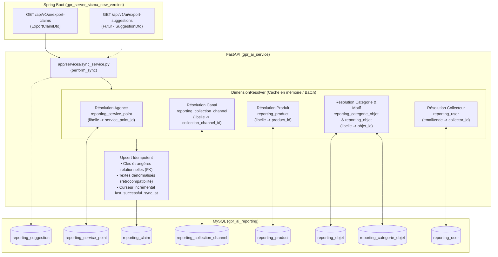

# Plan d'Alignement de la Synchronisation sur le Modèle Relationnel `gpr_ai_reporting`

> **Document de Référence Technique — Synchronisation Analytique**  
> Ce document formalise la refonte et l'alignement de la chaîne de synchronisation entre le backend opérationnel Spring Boot (`gpr_server_sicma_new_version`) et le service analytique FastAPI (`gpr_ai_service`), suite à l'application du schéma relationnel en étoile (Migration `007_create_relational_reporting_tables.sql`).

---

## 1. Contexte et Diagnostic de l'Existant

### 1.1. État Initial de la Synchronisation
À l'origine, la base analytique `gpr_ai_reporting` reposait sur une table plate dénormalisée (`reporting_claim`) :
* Les dimensions étaient stockées sous forme de simples chaînes de caractères (`agency`, `channel`, `product`, `category`, `motif`).
* Aucune table dimensionnelle ni table de workflow n'existait dans `gpr_ai_reporting`.
* Le service de synchronisation (`app/services/sync_service.py`) extrayait uniquement ces chaînes textuelles depuis l'endpoint Spring Boot `/api/v1/ai/export-claims` et effectuait un `upsert` dans `reporting_claim`.

### 1.2. Problème Suite à la Migration 007
La migration `007_create_relational_reporting_tables.sql` a introduit le modèle relationnel complet en étoile (15 tables au total) :
1. **Dimensions & Référentiels** : `reporting_service_point`, `reporting_collection_channel`, `reporting_product`, `reporting_categorie_objet`, `reporting_objet`, `reporting_existing_solution`, `reporting_user`, `reporting_poste`.
2. **Dossiers & Workflows** : `reporting_suggestion`, `reporting_historique_affectations`, `reporting_solution`, `reporting_satisfaction_measure`.
3. **Clés étrangères sur `reporting_claim`** : `service_point_id`, `collection_channel_id`, `product_id`, `objet_id`, `collector_id`.

**Les risques sans mise à jour de la logique de synchronisation :**
* `app/db/models.py` n'a pas encore déclaré les colonnes de clés étrangères sur `ReportingClaim` ni les 10 nouvelles classes de tables.
* `sync_service.py` continue d'insérer des dossiers sans renseigner `service_point_id`, `collection_channel_id`, etc.
* Lors des futures synchronisations, les nouveaux dossiers auraient des clés étrangères `NULL`.
* Les requêtes Text-to-SQL du catalogue homologué reposant sur `LEFT JOIN reporting_service_point sp ON c.service_point_id = sp.id` ne pourraient plus associer les agences ou canaux aux nouveaux dossiers.

---

## 2. Architecture Cible du Flux de Synchronisation



---

## 3. Plan d'Implémentation Détaillé

### Étape 1 : Mise à jour des modèles SQLAlchemy (`app/db/models.py`)
1. **Évolution de `ReportingClaim`** :
   * Déclarer les colonnes de clés étrangères :
     ```python
     service_point_id: Mapped[Optional[int]] = mapped_column(BigInteger, nullable=True)
     collection_channel_id: Mapped[Optional[int]] = mapped_column(BigInteger, nullable=True)
     product_id: Mapped[Optional[int]] = mapped_column(BigInteger, nullable=True)
     objet_id: Mapped[Optional[int]] = mapped_column(BigInteger, nullable=True)
     collector_id: Mapped[Optional[int]] = mapped_column(BigInteger, nullable=True)
     ```
2. **Déclaration des tables de dimensions** :
   * `ReportingServicePoint` (`reporting_service_point`) : `id`, `libelle`, `type`, `is_principal_agence`, `direction_id`
   * `ReportingCollectionChannel` (`reporting_collection_channel`) : `id`, `libelle`, `description`
   * `ReportingProduct` (`reporting_product`) : `id`, `libelle`, `description`, `is_deleted`
   * `ReportingCategorieObjet` (`reporting_categorie_objet`) : `id`, `libelle`, `description`
   * `ReportingObjet` (`reporting_objet`) : `id`, `categorie_id`, `libelle`, `risque_level`, `processing_time`
   * `ReportingExistingSolution` (`reporting_existing_solution`) : `id`, `objet_id`, `content`, `compteur`
   * `ReportingPoste` (`reporting_poste`) : `id`, `libelle`, `description`
   * `ReportingUser` (`reporting_user`) : `id`, `code`, `firstandlastname`, `email`, `service_point_id`, `poste_id`
3. **Déclaration des tables de workflows & suggestions** :
   * `ReportingSuggestion` (`reporting_suggestion`) : `id`, `source_suggestion_id`, `reference`, `title`, `status`, `impact_level`, `origine`, `recorded_at`, `service_point_id`, `product_id`, `collection_channel_id`, `objet_id`
   * `ReportingHistoriqueAffectation` (`reporting_historique_affectations`) : `id`, `reclamation_id`, `suggestion_id`, `nom_agent`, `nom_affecteur`, `date_affectation`, `delai_jours`
   * `ReportingSolution` (`reporting_solution`) : `id`, `claim_id`, `author_id`, `status`, `commentaire`, `is_ai_proposed`
   * `ReportingSatisfactionMeasure` (`reporting_satisfaction_measure`) : `id`, `solution_id`, `status`, `commentaire`, `measure_date_time`

---

### Étape 2 : Implémentation du `DimensionResolver` (`app/services/sync_service.py`)
Pour garantir des performances optimales lors de la synchronisation de gros volumes (500+ dossiers par lot) et une résilience totale :
1. **Cache en mémoire par session** :
   * Conserver des dictionnaires `{libelle_normalise: id}` pour chaque dimension (`service_points`, `channels`, `products`, `categories`, `objets`).
2. **Stratégie Get-or-Create automatique** :
   * Si un libellé d'agence arrive depuis l'export (ex. `"Agence Abidjan"`), le résolveur vérifie dans le cache.
   * Si non présent en cache, il interroge la table `reporting_service_point`.
   * Si absent en base, il insère automatiquement l'agence dans `reporting_service_point`, effectue un `flush` pour obtenir le nouvel ID, et le met en cache.
   * Même logique pour `reporting_collection_channel`, `reporting_product`, `reporting_categorie_objet` et `reporting_objet`.
3. **Double écriture pour rétrocompatibilité absolue** :
   * Conserver à la fois les colonnes textuelles historiques (`agency`, `channel`, `product`, `category`, `motif`) et les clés étrangères (`service_point_id`, `collection_channel_id`, `product_id`, `objet_id`).
   * Tout code existant consommant les textes continue de fonctionner sans régression, tandis que le moteur Text-to-SQL et le Query Catalog utilisent les jointures relationnelles.

---

### Étape 3 : Évolution Côté Spring Boot (`gpr_server_sicma_new_version`)
1. **Enrichissement de `ExportClaimDto.java`** :
   * Ajouter les champs d'identifiants techniques :
     ```java
     private Long servicePointId;
     private Long collectionChannelId;
     private Long productId;
     private Long objetId;
     private Long collectorId;
     ```
2. **Mise à jour de `AiController.java` (`toExportDto`)** :
   * Mapper les identifiants depuis l'entité `Claim` :
     ```java
     .servicePointId(claim.getServicePoint() != null ? claim.getServicePoint().getId() : null)
     .collectionChannelId(claim.getCollectionChannel() != null ? claim.getCollectionChannel().getId() : null)
     .productId(claim.getProduct() != null ? claim.getProduct().getId() : null)
     .objetId(claim.getObjet() != null ? claim.getObjet().getId() : null)
     .collectorId(claim.getCollector() != null ? claim.getCollector().getId() : null)
     ```
3. **Endpoint d'export des suggestions (Lot Suggestions)** :
   * Créer `GET /api/v1/ai/export-suggestions` pour permettre à `gpr_ai_service` de synchroniser également `reporting_suggestion`.

---

### Étape 4 : Validation & Non-Régression (`/safe-code-change`)

| Check | Composant | Critère de Succès |
| :--- | :--- | :--- |
| **Test Unitaire Sync** | `tests/test_reporting_sync.py` | L'upsert renseigne bien `service_point_id`, `collection_channel_id`, `product_id`, `objet_id` et conserve les textes. |
| **Suite Globale Reporting** | `tests/test_step_*.py` | 84/84 tests passent avec succès sans régression. |
| **Vérification Live MySQL** | `gpr_ai_reporting` | Exécution d'un sync live puis vérification que 100% des dossiers ont des clés étrangères valides. |
| **Vérification Requêtes SQL** | `query_catalog.py` | Les requêtes `QC-CLAIM-COUNT-BY-AGENCY` et `QC-CLAIM-COUNT-BY-CHANNEL` renvoient les données sans erreur 1146. |

---

## 4. Recommandation d'Exécution

Il est recommandé de déployer cette mise à jour selon l'ordonnancement suivant :
1. **Appliquer les Étapes 1 & 2** dans `gpr_ai_service` (`models.py`, `sync_service.py`, tests). Le `DimensionResolver` rend la synchronisation autonome et opérationnelle immédiatement, même si Spring Boot n'a pas encore redémarré.
2. **Appliquer l'Étape 3** dans `gpr_server_sicma_new_version` (`ExportClaimDto.java`, `AiController.java`) pour consolider l'alignement contractuel bilatéral.
3. **Valider l'ensemble** via la commande `/sync` et auditer l'état de la base de reporting.
